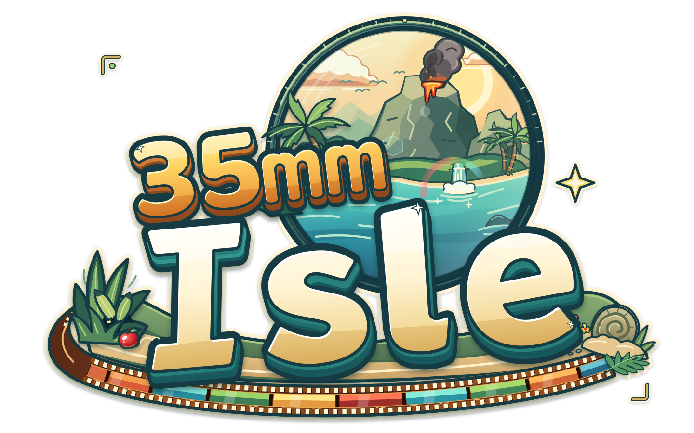

<p align="center">
  
</p>

# 35mmIsle 📸

**35mmIsle is the native port of Pokémon Snap (1999) to modern systems, based on [libultraship (LUS)](https://github.com/Kenix3/libultraship).** Target platforms are Linux x64 and Windows 11 x64.

The port builds on the authoritative [Pokémon Snap decompilation](https://github.com/ethteck/pokemonsnap), with integration patterns informed by other mature LUS-based ports. ROMs and extracted game assets are not distributed with this repository.

## Runtime status

The native Linux application has completed a [fresh, unseeded, one-profile campaign](docs/development/ADMISSION.md#fresh-unseeded-complete-campaign): all seven courses, naturally earned Apple/Pester/Flute/Dash, six sign Reports, Rainbow/Mew, full Original Credits18, acknowledged Save, visible Title and byte-exact cold profile reopen. The actual run completes **124 saved rides, 67 Reports and 141,110 points**, without authored progress, photographs, scores, equipment or profile merging.

The proof exercises actual Original Manager results, captured-photo selection and evaluation, canonical native graphics presented through libultraship, checked native audio through SDL's dummy device, and complete owner retirement. Separate shipping-application checks exercise ordinary SDL keyboard input through Title/Continue/Oak; the campaign driver supplies owned software controller input.

Published [`311155c`](https://github.com/PhilosophiMoonbeam/35mmIsle/actions/runs/39636639535) passes all ten Linux/MSVC jobs: native products, compilation of all 31 component consumers, 58 CPU contracts and portable Linux/Windows x64 Runtime archives. The Linux distribution also runs with the privately owned ROM. Windows ROM gameplay, Windows 11 hardware, physical-controller/audio-device qualification and N64 numerical/pixel parity are **not claimed**.

Earlier isolated and inherited-profile qualifications remain in the [admission record](docs/development/ADMISSION.md). They are historical evidence, not substitutes for the completed fresh campaign. ROMs and derived private development evidence are not distributed.

## Development documentation

Start with [PLAN](docs/planning/PLAN.md) for architecture and design decisions. The following documents cover source baselines, porting research, implementation contracts and validation.

| Document | Purpose |
|---|---|
| [PLAN](docs/planning/PLAN.md) | Proposed architecture, faithful core loop, decision register and stop/go questions |
| [ASSESSMENT](docs/planning/ASSESSMENT.md) | Independent planner/reviewer adjudication, H1–H8 amendments, tradeoffs and falsifying experiments |
| [BASELINES](docs/planning/BASELINES.md) | Seven immutable source pins, authority and preserved local-reference state |
| [DECOMP](docs/planning/DECOMP.md) | Authoritative Snap source, scheduler, assets, graphics/photo, save and audio boundaries |
| [LUS / Ghostship](docs/planning/LUS_GHOSTSHIP.md) | Current host APIs, template mismatch, resource/archive and rendering/readback contracts |
| [2Ship / MM](docs/planning/2SHIP_MM.md) | Paired native-port/decomp comparison: transferable patterns and rejected assumptions |
| [Shipwright / OOT](docs/planning/SHIPWRIGHT_OOT.md) | Independent paired comparison of lifecycle, resources, ABI, audio, saves and packaging |
| [ROADMAP](docs/planning/ROADMAP.md) | Dependency-gated work units, waves, ownership and integration contracts |
| [VALIDATION](docs/planning/VALIDATION.md) | Future original-ROM fixtures, behavioral acceptance and platform/release gates |
| [LICENSING](docs/planning/LICENSING.md) | Original-work MIT scope, third-party restrictions and import/publication gates |
| [INVENTORY](docs/planning/INVENTORY.md) | Frozen portability screening, direct-review evidence and coverage limits |
| [VERIFICATION](docs/planning/VERIFICATION.md) | Recorded development-documentation checks and their evidence limits |
| [BEADS](docs/planning/BEADS.md) | Planning/implementation issue mapping; Beads remains the live status authority |

The [upstream `ethteck/pokemonsnap`](https://github.com/ethteck/pokemonsnap/tree/df8815e75f3d79618466e01e0827c6165b93d11c) pin is game-source authority, not the modified local fork. The initial ROM baseline is the exact US version recorded in BASELINES.

## Project scope

The port's scope covers all seven courses, original interactions and unlocks, camera/focus/shutter, photo selection and Oak evaluation, report/album/gallery, durable save and cold reload, original audio, ending and credits. Faithful photography requires both per-object live focus-color history and reconstructed-photo depth/scoring semantics. ROADMAP and VALIDATION define implementation dependencies and fidelity requirements.

## Building the original runtime and tools

Requires CMake 3.24+, a C11/C++20 compiler, native thread support and a 64-bit target. Linux presets use Ninja; Windows presets use Visual Studio 2022 x64. The default build is independent of LUS and all game/reference checkouts:

```sh
cmake --preset linux-release
cmake --build --preset linux-release
ctest --preset linux-release
build/linux-release/35mmisle-rom check /path/to/pokemonsnap.z64
```

```powershell
cmake --preset windows-release
cmake --build --preset windows-release
ctest --preset windows-release
.\build\windows-release\Release\35mmisle-rom.exe check "C:\private\pokemonsnap.z64"
```

Debug presets are `linux-debug` and `windows-debug`. CTest executables exercise independently authored native memory, ROM identity, GTL clock/context policy, stackful processes, owned queues, VPK0, compiled-C continuations, typed sprites, packed-depth photo reductions, audio resources/readers/players/synthesis/effects, controller publication and checked save codecs/persistence/startup state; checks remain active in Release. The private game engine adds actual upstream C dispatcher, fade and camera/model computations with synthetic data. Public jobs never receive a ROM or extracted game content.
The optional RSP composition adds coprocessor and required-work lifetime regressions using original synthetic instruction programs and caller-owned memory, not a public microcode dump. Published `23f4c05` passed [all ten Linux/Windows CI jobs](https://github.com/PhilosophiMoonbeam/35mmIsle/actions/runs/39054672591), including MSVC x64 Debug/Release, the renderer/shader compiler, full static-runtime LUS/audio/RSP/RDP/native engine and explicit compilation of all twenty-four then-existing opt-in consumers without a ROM. That immutable evidence includes the genuine first-entry actor closures and preceding renderer/Photo/World work—not the subsequent complete Player Root, private Windows11 gameplay or hardware/hearing qualification.

At published `ef98b67`, the common movement wave supplies 32 complete pinned C helpers, nonowning native model-incarnation references and bit-preserving canonical local/AUX stores. The World cutover uses one C-compatible `IsleWorldMovementState`, not a C++ mirror or layout alias; foreign opaque block identities reject before callbacks or native animation change. That immutable revision passed all 56 CPU contracts in local Debug, Release and Clang ASan+UBSan and all fourteen complete CPU/API/audio-RSP/GPU consumers per profile: 42 frozen whole-process-tree-qualified executions and 2,601 closed terminal tasks, including the full eight-primary/four-secondary World GPU consumer. Genuine source Magikarp movement has same-state component-only color/depth controls and exact restoration; all 21 surfaces remain byte-identical across profiles and to the preceding movement wave. Audio is owned CPU PCM, not an exercised SDL3 stream/device. These receipts do not qualify subsequent Player changes, remaining species callbacks or full gameplay; see [admission evidence](docs/development/ADMISSION.md), `cmake/world-inputs.json` and `cmake/actor-interaction-inputs.json`.

Native preparation retains strict source-byte hashes. `.gitattributes` preserves LF for admitted support inputs even under Windows `core.autocrlf=true`; an earlier real CRLF-policy checkout matched all 97 then-hashed support files and completed Item source preparation. Player support/importer paths have explicit LF attributes. Published MSVC builds exercise their corresponding immutable revisions. The current Linux canonical RDP and full MSVC recipes enable `BUILD_TESTING` and explicitly compile all twenty-five opt-in consumers without a ROM; hosted qualification remains tied to the published revision above.
Published `588dc41` passed seven hosted jobs, but all three engine-enabled Windows configurations correctly rejected a newly hashed `menu_scene_bridge.h` checked out as CRLF. The missing LF attribute was fixed without changing or weakening the seventeen support hashes. A real isolated `core.autocrlf=true` checkout matches all seventeen inputs and executes the strict command importer with exact generated C/header identities; corrected revision `d936b02` then passed all ten hosted jobs.

Published `c079c6d`'s 496-file native snapshot `e5056805` passes all 57 CPU contracts and all 22 complete component consumers in Debug, Release and Clang ASan+UBSan: 66 source-identical executions, 3,588 closed terminal tasks and unchanged ROM. Actor production exposes transactional raw per-object/prefix fragments; original C Photo capture runs at the prefix before matching history is sealed; Detector leases use committed generations; checked C process creation preserves native callback/kind/priority ownership. A reproduced CopyInfo first-error overwrite is fixed. All 63 prior surface images, 213 Photo files and 12 Cart files remain byte-identical. These are renderer/Root prerequisites, not execution of the complete 106-definition Player Root, remaining species or full gameplay.

Published `6c7e3ca`'s native snapshot `3ec8fedd` adds checked World/Movement callback results, complete original vector helpers and a synchronous source-controlled camera phase before generic emission. It passes all 57 CPU contracts and all 22 actual consumers per profile, with 3,702 closed terminal tasks and unchanged prior image/Photo/Cart bytes. Real UI GPU controls prove late native-object visibility re-gather, source black fill without generic overwrite and nested C-fence failure with C++ sink cleanup. Full original camera routing, Root initialization and complete first-entry species closure remain implementation work.

The 500-file native snapshot `d8a794c9` adds 13 complete pinned Butterfree/Doduo C definitions and checked object-wide process/link-ID helpers. Both genuine factories run with canonical Player prepared but object/model and FX unpublished; the same actors later execute under the actual native scheduler. Butterfree preserves ground-first initialization followed by its late airborne AUX-Y write; Doduo uses the original ground factory. Native paths, RNG waits, queued hit/Jump/Fall, FIFO process pause/resume, actual proximity command16, cleanup/reuse and owned audio-RSP drain pass. All 57 CPU contracts and all 23 consumers pass Debug, Release and Clang ASan+UBSan: 69 source-identical cases, 3,760 closed terminal tasks, unchanged ROM and unchanged 63 prior images/213 Photo files/12 Cart files. New species qualification is CPU/native-C and owned PCM, not new GPU pixels, SDL-stream/hearing, full Player Root, complete first-entry factories or Windows11 gameplay.

`isle-player-renderer` executes thirteen complete pinned camera/light definitions through checked plain-C boundaries. Genuine camera scheduling, World/Actor/Item/Cart source order, late FX/UI visibility, original borders/blink, Photo preparation/completion and signed light direction share native ownership and real GPU fences. Four bounded lanes preserve source camera/task order, including the literal lane 1→3 reload placement; programs 2/8 execute as actual RSP tasks. Existing-context ProcessImage requests now retain the original two-entry ID FIFO independently of GPU snapshot holds, including callback removal; the expanded standalone renderer/Photo regression cohort still needs its new runtime qualification. Camera task-flush flags `0x10`/`0x40` remain separately tracked native multi-task work. Wire diagnostics are not original ROM line-asset parity; these mechanisms do not establish full-game qualification.

The 508-file native snapshot `aa0acc08` builds all 24 opt-in consumers and passes all 57 CPU contracts in Debug, Release and Clang ASan+UBSan. All 72 complete component executions are source-identical: 5,090 closed terminal tasks, unchanged ROM and zero known physical-device attempts or permission errors. The preceding 63 images, 213 Photo files and 12 Cart files remain byte-identical; 60 new camera output/report files also match across profiles. Actual Git filtering with Windows `core.autocrlf=true` preserves all 125 strict support inputs. This is native component evidence, not full-game or private Windows11 qualification.

The first-entry behavior cutover compiles 130 pinned actor C definitions. All eight initial actors—Butterfree, Doduo, Pikachu behavior 4, sign `1004`, three Pidgey and Lapras—spawn before Player/FX publication and execute their genuine states in Debug, Release and ASan+UBSan. Native shared signals, paths, weighted states, flute/apple interactions, source progress thresholds and owned audio-RSP drain are exercised. Actor `1004` is the progress-dependent photo sign; the ending sequence belongs to separate actor `1001`. The following Root result extends this first-entry component, not the remaining course/species closures or full game.

Its 508-file source snapshot `4596925a` passes all 24 component consumers in all three profiles: 72 accepted complete executions, 5,634 closed terminal tasks and unchanged ROM, with zero known physical-device attempts or permission errors. All 348 previously qualified render/Photo/Cart/camera files remain byte-identical. Actual Windows-style Git filtering preserves all 125 strict support inputs. This remains native component evidence, not complete Player Root or full-game qualification.

**Original Player Root.** `isle-player-root` compiles all 106 pinned Player definitions with one canonical owner per body: 92 Root, two engine-support, ten renderer and two command functions. Thirty-seven returning native leaves compose the existing World/Actor/Item/Cart/UI/Photo/audio services; gameplay remains original C, not a C++ replacement FSM. `isle-beach-music` executes the complete original Beach music callback over its real ROM-initialized state.

The 519-file Root snapshot `6e6a8211` passes actual GPU/readback, native/semantic collection and independent PCM drain in GCC Debug, GCC Release and Clang ASan+UBSan. It executes genuine Player7 startup, all eight first-World factories, zoom, three qualifying photos and tutorial release, original pause/resume, interrupted and completed idle exits, and the ordinary no-song third music iteration. All 59 raster/depth/Photo binary outputs are identical across profiles; each run closes 335 terminal tasks with unchanged ROM and zero known physical-device attempts or permission errors. Original pause/message/terrain/Pidgey surfaces and both black idle terminal frames were visually inspected.

All default targets, all 25 opt-in consumers and 57 CPU tests pass local Debug, Release and Clang ASan+UBSan; the final Root executable is additionally rebuilt and exercised in every profile above. The subsequent 527-file Debug integration also compiles both original application/Beach Source providers and passes all 57 CPU tests. Its expanded Renderer passes all eight actual GPU scenarios and preserves all 20 prior positive files.

The expanded Photo Debug consumer passes its runtime checks and preserves 70 of 71 prior file hashes. A fresh immutable public-before build reproduces the remaining old hash exactly. The new record differs only in three primitive-color bytes of an inactive effect (`textureID == -1`); original reconstruction skips that entire payload. Both raw hashes remain recorded; no expected value or production state is changed to manufacture byte parity. Complete courses, post-course scenes and independent Original/hardware/hearing/Windows11 qualification remain open. [Admission and change record](docs/development/ADMISSION.md#complete-original-player-root).

**Original application integration.** The real `35mmisle` executable composes the original C manager with Boot, Title, Name, Oak's Lab and Beach owners. All 17 Beach factory families, their alternate/singleton factories and complete native callback/graph/weighted admission are integrated; original C chooses behavior. Actor `1005` retains its genuine disabled animation setup, not an invented header.

The actual original-manager Boot → Title → Name → Oak → Beach run completes the strict full-Beach contract: four photographs, three qualifying shots, original tutorial/follow-up/stick transitions, natural travel, original ending sound/cart/outro and verified retirement. The historical 599-file checkpoint completes 5,233 canonical GPU frames/LUS presentations and accepts 12,684,944 SDL-dummy PCM frames. All 474 traced tasks terminate; ROM unchanged, zero physical-device or permission hits. Its three tutorial/travel/outro windows were visually inspected. That checkpoint ends at CameraCheck9 with exit 2; the later 635-file qualification below completes both original post-course entries.

At the 572-file checkpoint, the ROM-dependent post-course interface consumer passed actual canonical photo-store/projection and returning Text/Frame/Layout operations with genuine native OM updates. Coverage includes retained saved-photo/comment aliases, snapshot isolation, flag-only writes, report/sign mapping, transient grants, and cancellation during partial button creation followed by same/different replacement. These are native-service proofs, not completed CameraCheck/PhotoCheck scenes, reconstructed photos or scoring.

The 599-file Debug snapshot `9f1227a7` builds all default targets and 30 opt-in consumers and passes 57 CPU tests. Actual canonical RSP/RDP replay previews render all seven course worlds; nine completed surfaces were visually inspected. An authored Pidgey record changes 346 canonical bytes relative to identical terrain-only input. Shared-executor exclusion, stale-admission rejection and cancellation after genuine GPU submission finish with joined native owners. This is recorded-photo reconstruction evidence from authored records, not seven playable courses, captured-photo evaluation, Original/hardware parity or Windows11 qualification.

The 637-file snapshot builds default targets and 31 opt-in consumers and passes 57 CPU tests. Beach/Rainbow catalogs decode and install their complete ROM data; actual native-C actor, FIFO, focus and contextual Item collision proofs pass. Eleven Window GPU frames, all-seven-world previews and C-owned Replay scoring/thumbnail/stop proofs pass. Source-correct single-image Elements fit PhotoCheck's original fixed UI heap. Rainbow's typed Source providers execute the original intro, controls and pause/Retry result6, join the old native owner, enter a fresh Rainbow6 owner and complete held-frame STOPPED shutdown. That bounded route uses an explicitly authored official progress fixture; played unlocks and natural Rainbow completion remain unqualified.

The 637-file application snapshot completes Boot → Title → Name → Oak → full Beach → CameraCheck9 → PhotoCheck15 → constructed Oak13 admission, with 5,972 canonical GPU submissions/presentations and 13,314,912 SDL-dummy PCM frames. Original Source marks the captured Pidgey, scores it at 3,300 and stores the identical photograph in the Report; all scene/native owners join. All 590 traced tasks terminate; ROM unchanged, zero physical-device or permission hits. All seven selected Beach/post-course surfaces were visually inspected, including the completed Camera prompt and clean 3,300-point summary. Zero-step sprites retain their original repeated geometry, using compact texture setup and the existing shared 64-KiB command arena. Return Oak is admitted, not yet rendered or interacted with. This is not seven playable courses, Original/hardware parity, audible output or Windows 11 gameplay. [Qualification details](docs/development/ADMISSION.md).

Hosted cohort `1efb182` passes all ten Linux/Windows jobs, including the actual Windows x64 application and post-course consumers, 57 MSVC CPU tests and `35mmisle.exe --help`. Hosted Server-2022 compilation is not private-ROM Windows execution or Windows11 gameplay. [Hosted build evidence](https://github.com/PhilosophiMoonbeam/35mmIsle/actions/runs/39132219406).

The 646-file native-resource cohort builds the application and 31 opt-in consumers and passes 58 CPU tests. Actual ROM-backed production consumers close all seven actor catalogs, install their exact RAM data and consume all 551 receiver-qualified animation headers. All seven behavior catalogs also pass, preserving signed sentinel lists separately from counted u8-weight lists and real NULL outcomes. Source sparse texture holes, initially disabled/later animated models and sequential River LOD clocks retain their distinct admission contracts. The new C-only fault fence passes real Game/Player lifetime and ASan checks. These data/SDK results do not activate the remaining five courses; their Original actor/lifecycle providers and shared native host remain in implementation.

The canonical executor also passes a genuine CPU-Vulkan backend-failure smoke: asynchronous polling, blocking retirement/execution, outstanding-work destruction, consumed-token rejection, and cold/warm raster reuse in a fresh executor. Failed work exposes no memory lease; actual GPU draining stays on its worker. Device loss and prolonged drain remain untested.


C command-ownership fixtures use the native arena’s absolute-address alignment rather than a toolchain-dependent C `max_align_t` declaration. Backing capacity, queue admission, fault propagation and real worker-join checks are unchanged.

Implemented executable and native services; full-game qualification remains open:

- `35mmisle`: original-manager application, user-supplied supported ROM, native input/Audio/GTL ownership and canonical RSP/RDP rendering with optional copied LUS presentation. `--help` documents development options; unimplemented scene entries fail explicitly rather than masquerading as completed scenes. Installed dependency/notice and release-composition review remains separate.
- `35mmisle-rom` / `isle-rom`: read-only exact-US image validation in z64, v64 or n64 byte order, without writing normalized ROM data.
- `isle-native`: checked C11 arithmetic, caller-backed arenas and bounded spans. `35mmisle/rng.h` adds explicit replayable seed state, the game's full-high16 LCG and guest-tick random projections, with defined signed-wrap/range arithmetic. Guest tick values are supplied by the caller; this does not substitute a host wall clock or qualify cross-domain timing.
- `isle-host-clock` (private host integration): bounded GAME-derived retrace/update/draw policy, exact rational time accumulation, owner/epoch/serial-qualified context leases and checked pause/reset/stop transitions. It preserves a pending blocking receive across interval changes and closes admission immediately on execution failure. Actual C game ownership and optional presentation remain separate; this is not full scheduler, input, AI or scene qualification.
- `isle-process` (`35mmisle/process.hpp`): an original stack-preserving `isle::Process`, implemented with a parked, joinable native worker and synchronous creator-thread handoff. Only the creator may resume, inspect, cancel or destroy it. `Yield::wait(0)` stays inline; `wait(N)` resumes the same stack after exactly N subsequent `resume()` calls. Cancellation unwinds and joins at cooperative boundaries, not during non-yielding callback execution. Successful waits/resumes do not allocate or copy callbacks. Native FP state is isolated across waits; that is not R4300 FP or Snap scheduling equivalence. Callers must honor the header's exception/unwind and lifetime rules and compile callback arithmetic with dynamic-FP-aware options.
- `isle::MessageQueue<T>` (`35mmisle/message_queue.hpp`): a bounded, construction-allocated, move-only ownership ring with blocking and nonblocking push/pop. `accepted` means admitted ownership, not completed work; failed pushes retain caller ownership. `close()` rejects new messages, wakes waiters and permits FIFO drain. Payload move/destruction must be nonthrowing, nonblocking and non-reentrant; prevent new access and join users before destroying the queue. This is not an N64 priority scheduler.
- `isle-vpk0` (`35mmisle/vpk0.hpp`): the original allocation-free decoder contract described below.
- `isle-continuation` (`35mmisle/continuation.h`): a C ABI over genuine stackful processes. Callback-created children rendezvous with the central owner; cross-cancellation joins before user storage can be recycled. The C trampoline fences control transfer: no C++ exception crosses a C frame. Intervening callback frames must not retain owning C++ automatic objects across wait, finish or failure; C resources require explicit object/scene ownership.
- `isle-sprite` (`35mmisle/sprite.h`, `35mmisle/sprite.hpp`): checked big-endian Sprite/Bitmap graph hydration with immutable bank ownership, canonical RGBA/CI/IA/I texel normalization and odd-row texture shuffle. Positive `actualHeight` determines stored planes; zero uses nominal height. Bare C views borrow their owning `Sprite`; renderer completion must precede owner release. This is not the original RDP DMA footprint or full Sprite renderer.
- Internal `isle-pidgey-resources`: immutable exact-ROM HD photo-Pidgey hierarchy, material/texture, vertex/display-list and pose-0 stream views. Installation writes 42 checked guest-addressed spans into caller-owned canonical memory, preserving unrelated bytes. Animation/render work belongs to the native producer below.
- Internal `isle-beach-world-resources`: checked immutable Beach world/block metadata and the complete first static terrain/sky display-list, vertex, texture and palette closure. Shared `rom::GuestView` preserves explicit guest/ROM/native address domains. Other blocks' geometry and dynamic material/road/spawn execution remain separate.
- Internal `isle-model-assets` / `isle-model-data` / `isle-beach-actor-resources`: one relational graphics closure shared with World and one cold tree/material/program decoder shared by actors and items. Complete Beach actor data remains 17 models, 79 headers, 33 materials and 1,317 programs; the unchanged actual-ROM consumer evaluates every header through the existing animator after the decoder cutover. Native factories and scene ownership remain separate below.
- Internal `isle-item-resources`: all four source families—pester ball, apple, water splash and lava splash—retain four models/materials, eleven programs and a complete graphics closure over original Snapshot aliases. The real shared-animator consumer visits all eight/six STEP image choices, preserves model1/texture0.4/splash0.9 speeds and NULL callbacks, checks the source fume-time cutoff and finite terminal time, then retires and rebinds moved storage. This is not native item physics, item ownership or gameplay.
- Internal `isle-beach-behavior-resources`: all 70 Beach interaction graphs plus the common empty graph, eight weighted-state lists and the distinct two-choice scene table. Bounded original records, unused terminal fields, weighted NULL no-spawn choice, exact-identity lookup and retained Snapshot lifetimes are preserved. Guest identities remain data; no callback casts, command interpreter or species admission is inferred.
- `isle-audio-bank` (`35mmisle/audio_bank.hpp`, `35mmisle/audio_sequence.hpp`): immutable, alias-preserving BE B1 sample graphs and S1 sequence catalogs, with retained input owners and checked offsets/extents. Signed envelope/detune/coefficient fields and partial ADPCM loops remain intact. S1 preserves declared payload length separately from even-DMA padding, including bounded aliases and gaps; all 37 original entries have been exercised privately. This is resource hydration, not compressed-event interpretation, sequencing, synthesis or an audio-ready signal.
- `isle-audio-sequence` (`35mmisle/audio_cseq.hpp`): allocation-free compressed-MIDI event decoding over retained S1 views, with value-copyable cursors, independent loop counters and atomic failure. All 112,733 qualified original public events across 37 actual sequences match: eleven terminal streams and twenty-six bounded 4,096-event prefixes. This is event decoding, not a CSP/MIDI voice player, ADSR, effects or BGM PCM qualification.
- `isle-audio` (`35mmisle/audio_synth.hpp`, `35mmisle/audio_sfx.hpp`, `35mmisle/audio_csp.hpp`, `35mmisle/audio_effects.hpp`): retained catalog, shared ABI1 synthesis, independent SoundPlayer and compact-MIDI sequence clients. One service owns up to 22 physical filters, 42 logical descriptors, three typed client calendars, a shared 44-slot modulation pool, stable RDRAM and a graph-wide task/PCM lease. Original ROM microcode performs decoding/resampling/mixing; no SDK producer body is imported. Finite SoundPlayer lifecycles, CSP scheduling/controller semantics, FX sends and static wet graphs have bounded actual-RSP qualification. A chorus candidate adds checked modulated taps and persistent resampling state; original-producer arithmetic and capture-admission counterexamples remain open, including an admitted `depth=50000` case. Complete BGM PCM, original AI scheduling and the short-envelope packed-rate counterexample remain open.
- Opt-in `isle-engine` (`35mmisle/engine.h`): native arena-backed GObj/process/SObj/camera/model ownership around forty-one reviewed GAME definitions. Typed source processes retain authoritative ordering, waits, function identity and joined retirement; native update context remains separate from GAME actor payload. Cameras provide stable caches, pure metadata preflight and atomic dirty matrix/reflection/normalization publication. Translate-only/kind-28 local matrices remain independent of RT/RTS placement. Explicit contextual RPY nodes retain full finite poses without pretending their reserved local fixed bytes are renderable; checked source54 fixed-W and source48 camera-basis math supplies renderer-owned payloads. Native C-libm seams do not establish original trig-bit parity.
- Internal Player camera mechanisms: allocation-free bidirectional native ownership and checked source-exact viewport conversion, including fractional coordinates, signed low-sixteen-bit lanes and nonmutating rejection. Actual Debug/Release/ASan+UBSan programs execute original C configuration/removal fragments, publish a complete initial pose, compute matrices 3/14 and delete the main object without changing a distinct UI camera. The Root component additionally exercises real creation/render dispatch; production application and remaining course policy are separate.
- Internal Player execution context (`player_source.h`): one retained C state record and per-game contextual association; helpers do not reinterpret Actor/Item/Player payloads. C-only nonwaiting guards finish returning C++ leaves before checked failure transfer and reject positive waits. Actual callback identity, cold guarded entry, stackful resume and ownership errors are covered by 57 local CPU contracts in Debug/Release/Clang ASan+UBSan. Complete 106-definition import and genuine Root execution are qualified as the component above, not application/full-game completion.
- Internal `isle-player-commands`: a nonallocating bridge routes canonical Player Source commands through the existing native C interpreter and Scene Services queues. Local C failure fences close actual dispatch/current credits before propagating the first error; genuinely live suffixes remain retained until real receiver cancellation. Original camera handler/update and the canonical empty reticle handler execute privately, with real updater disable/restore, builtins, sends, retired senders, deletion/reuse and appended-suffix faults. The earlier 22-consumer/66-case cohort retains its immutable evidence; genuine Root now exercises the bridge without a fixture Player.
- Internal Source sprite execution: canonical first-sprite lookup, checked C-only native-view borrows and five authored scalar operations replace Root's sprite SDK calls without layout aliases or copied mutable state. The complete original `Pause_HideUI` runs on the actual kind-0 scheduler in all three local profiles: nine native sprites, twenty yielding updates, the twenty-first-update self-end, exact position/alpha/visibility transitions and joined object deletion. The subsequent genuine Debug Root also renders and visually verifies the original pause menu.
- Internal `isle-player-ui` and source screen transitions: 43 complete pinned message/Icons/film C functions and 15 transition C functions use actual immutable glyph/sprite/shape resources, native FIFO and canonical RSP/RDP. Whole consumers pass all three local profiles: ASCII/EUC-JP, controls, alpha/shadow, Icons, film bounds, hide/show/delete, source camera/viewport, solid and offset shape transitions, delayed joins and graphics/readback retention. Glyphs and a distinct source-kind-1 aperture surface were directly inspected.
- Internal `isle-player-photo`: 24 complete pinned C functions retain the application-lifetime 60-photo roll, source snapshot/selection/query behavior and explicit big-endian PhotoData codec. Actual World/Actor/Item/FX snapshots bind to the accepted Frame and submission ticket; Detector history context is independent of the physical framebuffer context. The C shutter transaction borrows that publication, calls original `makePhoto`, releases even after failure, then returns before Root's checked transfer. Published-focus query and presence-only clearing use the actual Detector, not retained mirrors. Each local profile passes 64 GPU Frames with independent framebuffer selection, two completed-callback failures and 73 original-C CopyInfo updates; all 71 output files remain byte-identical. Production input-driven capture, prefix-time full-renderer integration and full photo replay/scoring remain separate.
- Internal `isle-player-bump`: all five complete C functions use actual Actor placement/radius/distance, strict source thresholds, command4 FIFO and joined sender ownership. Each local profile passes genuine Magikarp geometry, queued then canonical Actor-field retention, deletion/reinitialization and owned audio-RSP drain. Its receiver is explicitly a bounded C harness, not the full Player FSM.
- Internal `isle-player-camera-animation`: the existing compiled Runtime drives the actual native camera with fresh written-channel publication, not another interpreter or pose cache. The admitted title clip (index115, mask `0x277`, source end1860) passes all three local profiles with matrices3+14, Set/one Update, NULL/rebind/skip, speed/flag2 behavior, intervening edits, typed errors and sequential owner retirement. This does not admit every production course-camera program.
- Internal `isle-player-cart-resources`: Snapshot-backed 43-node/eight-material cart, 78 model/twelve material/two Beach camera streams, six paths and complete bounded graphics closure. Reached model/camera path commands use the existing Runtime and native camera. Full clip, half-frame, skip, END, visibility and material consumers use independent pinned GAME binary32/path mathematics and independently decoded DATA, without increasing the `0.002` threshold. This is not the original cart C owner or course intro/outro lifecycle.
- Internal `isle-player-cart`: all four complete original C control functions execute through prepared native objects, the shared Runtime and C-fenced per-object callbacks. Every Init creates a fresh cart; current-pointer, independent NULL-domain, source-control, FIFO, caller and actual GPU/readback retention rules remain distinct. The shared J-fogged kernel emits genuine cart geometry/materials in Services DL3 order, with per-object fragments for composition. Debug, Release and Clang ASan/UBSan pass source-camera intro/fresh-outro RSP/RDP, independent RAM/epoch, reordered fragment and failure-cleanup consumers. At published `79463d3`, all 21 consumers pass their three-profile/63-whole-case cohort and 57 CPU tests per profile. Original Beach intro/outro continuations and full Player/game integration remain separate work.
- Internal actor controls (`actor_source.h`): six exact pinned GAME C helpers retain the existing native scheduler, real waits, state/path/auxiliary ordering, function identity and application RNG. Required lookup still rejects absent or unrelated payloads; nullable lookup distinguishes genuine absence from foreign identity or corrupt ownership. The coordinated owner below adds genuine common1003 and Magikarp source execution without another scheduler or clock.
- Internal source ownership in `scene::Services`: the same registered native owner retains identity and semantic storage through successful FIFO enqueue, active delivery and actual canonical apple/target-field borrows. Adoption precedes old-borrow release; ordinary FIFO suffixes survive transfer. Actual retirement closes receiver-owned cycles, while joined collection still waits for every source and graphics borrower. Unregistered custom senders reject before source-queue publication; unrelated menu objects remain opt-in.
- Internal `isle-actor-owner`: one canonical source record per native GObj, one shared Runtime/FX owner and pinned GAME C state/path/update definitions. Existing complete common1003/header/FIFO/sound-FX/identity acceptance remains intact. Genuine Magikarp129 passes actual Debug/Release/Clang ASan+UBSan CPU factory/state/path, initial/state header distinction, shared-RNG yaw, exact ground-wait/first-eligible emission, same-owner common sibling, nonzero normalized velocity, source ID wrap/second-pass/occupied-max fallback and native/audio cleanup. Other species callback/resource closures remain explicitly unadmitted; native photography integration is below.
- Internal `actor::BehaviorBindings`: constructor-only typed callback/graph/weighted-list closure over existing immutable data, with exact native function identities and complete requested dependency admission. All 71 graph resources remain distinct from executable closure: the registry currently compiles six common/Magikarp callbacks, not every Beach species. Unknown reachable native callbacks or incompatible factory/resources reject before the corresponding custom command is consumed.
- Internal original-C interaction execution: complete `Pokemon_RunInteractions`, `Pokemon_HandleCommand` and `Pokemon_Update` use one native FIFO and eleven returning native service leaves, not a second C++ interpreter. Source row ordering, strict boundaries, auxiliary/state process priorities, retained sender/field identities, consumed-prefix faults and ordinary suffixes are exercised. Command19 preserves valid NULL-current-World equality and last-match semantics. Actual automatic/FIFO CPU/API consumers pass all three profiles with compatible Magikarp129 and rejected incompatible1003 callback closures; the registered Player fixture is not the production Player FSM.
- Internal `items::Owner`: 53 privately compiled pinned GAME definitions retain source throw/flight/collision/apple/pester/fume/Flute behavior over actual native models, World and Actor services. Twenty logical entries, the original 0–19 cursor/300+i IDs, overall-oldest threshold ordering, NULL-payload fumes and real command21/22 lifetime are preserved. Admission prepares actual unpublished model/object/continuation resources before source side effects; rejection leaves native/source/Runtime ownership intact. Seven complete private scenarios cover physical rejection, source thresholds, real waits, fault cleanup and retained identity reuse. Position-only effect publication preserves the actual bank3/script0 velocity.
- Internal `items::Flute`: source songs1/3/2 and commands5/6/7 follow the accepted shared audio-build epoch, retained song index and natural source flags. Each profile executes all nine actual audio-RSP comparisons, 828 tasks, exact direct-song/restart PCM and nonzero muted-counterfactual differences before owned CPU PCM drain. This is not SDL3-stream, hardware-hearing or Original numerical parity.
- Internal `isle-borrowed-model-producer`: resource-agnostic retained packet construction now replaces the deleted Item-specific producer and composes native models through the shared kernel. Actual image/next-image/palette indices validate before RAM publication; preparation, GPU/readback, native joins and semantic retirement remain distinct. Historical mixed-Item GPU proofs cover reveal/rehide, foreign same-topology rejection, fume/wait residency, command21/22 retirement and replacement geometry/RGB5/depth. The shared cutover builds and runs in actual Beach; complete mixed-Item GPU requalification remains separate.
- Internal `actor::photo` in `isle-actor-owner`: canonical AUX/root collision position, explicit eye/at/up camera math, depth/truncated-screen bounds and ordered hidden/tangible/distance/species eligibility. A checked actual native link-3 cursor collects the first twelve accepted objects in source order, stops before the tail and preserves flag100 visibility effects. Errors preserve Photo output but may retain earlier native visibility mutations; this is focus membership, not full serialized photograph payload.
- Internal `isle-actor-photo-scene`: actual root-0 synchronous priority-2 complete collision manager, native prefix object and separate CopyInfo object-update publication. Producer preparation retains old preprefix gates, collects at the included prefix and reads new postprefix gates before one kernel stage. Failed preparation does not publish detector/RAM state. Validated live-root observer detachment remains possible after sticky scene failure; native joins and GPU completion remain separate.
- Internal `actor::collision` / `Owner::update_collisions`: one canonical full ground record, real World queries and source-ordered walking/pair response. Logical order, cached outer positions, strict 3D overlap, the original asymmetric inner-flag bug, blocked-walk ground effects and command26 suppression are preserved. Actual native APIs and a six-frame/four-update terrain GPU scene pass Debug/Release/Clang ASan+UBSan; authored collision inputs do not admit the separate non-NULL-graph species state.
- Internal `actor_spatial.h`: nonwaiting actual AUX/root distance and native link-3 neighbor queries across owners. Source NULL/second-model absence, strict 3D distance100, ordered distance-weighted away-vectors, zero/subnormal normalization and canonical neighbor direction remain distinct from renderer poses and collision-pair membership. Retired models are errors, not recycled-address recovery.
- Internal `isle-beach-magikarp-scene`: genuine current/current zero-spawn factory then native trigger-DObj-to-AUX copy, complete weighted chooser including NULL, strict surface/distance gate, shared RNG before active gate and canonical latch lifecycle. Actual Debug/Release/ClangASanUBSan consumers retain the fixed 512-update envelope. The unwritten source path/behavior tail has an explicit native NULL/zero policy, not claimed Original stack equivalence. Caller-owned native trigger/player inputs are not Item/Player gameplay.
- Internal `isle-source-angles` / `isle-environment-sound`: exact-ROM signed-angle lookup and Beach's 53 sound descriptors over the real shared audio session. Source category replacement, hearing cutoff, camera-relative attenuation/pan, pitch and fixed-voice retirement are implemented without SDK bodies. An actual RSP consumer exercised category isolation/order, camera reversal and two parked native joins while retaining the detached voice: 57 tasks and 30,496 checked stereo frames. This is owned PCM proof, not physical hearing or actor-event/gameplay integration.
- Internal `isle-menu-animation`: one compiled evaluator with preallocated instance slots and explicit pool/slot/incarnation identity. Source opcode14 follows validated in-stream targets and resets clocks without restarting tracks, rates or receiver selection. Finite graphs use certified bounds; cyclic owners specify fixed command/event capacities with allocation-free preflight and atomic rejection of overflow or binary32 stagnation. The native owner coordinates header/force/pause and sound/FX policy; complete species/gameplay integration remains separate.
- Internal `isle-menu-model-producer`: one borrowed kernel shared by Title, World and actor models, with source28/54 and translate+44/48 recipes, inherited XYZ and renderer-owned contextual residency. Actual RSP/RDP preserves five Title models/292 nodes and eight primary/four secondary World blocks. Pure camera preflight and complete native-storage disjoint validation precede publication. Source NULL draws skip material/call emission while preserving valid I pre-only work. Actual actor qualification is described below; no complete gameplay renderer or product executable is implied.
- Internal `isle-actor-producer`: actual Beach camera3/14, callback-specific fog, canonical Pokemon id/flags, visibility and link/tag policy over the shared kernel. The unchanged six-slot actual GPU cohort covers Snorlax54, two Pikachu48 instances, retained-texture1006, geometryless1005 and common1003; mutation, atomic rejection, residency, retirement/respawn and source-ordered detector capture pass. Genuine Pikachu/Snorlax focus and completed writeback retain source poses/scales/LOD/threshold. Native photo membership is supplied by the scene controller; complete course/gameplay integration remains open.
- `isle-focus-detector` (`35mmisle/focus_detector.hpp`): allocation-free two-context live-color history, preprefix append, full-16-bit 8×8 comparison, source 32-pixel threshold, ordered candidate/photo membership, cleanup and explicit deferred publication. Actual GPU histories and completed-memory writeback pass alongside CPU/native API contracts; the source's 21 red-center positions are checked while neighboring pixels/depth/hidden RDP data remain unchanged. Complete snapshot production, update queue and photo reconstruction remain separate.
- Internal `isle-focus-capture`: bounded source center-tile/COPY lists and shared 20-row GPU pool, with real framebuffer-context restoration. The canonical completed-memory lease exposes an explicit CPU write phase with actual consumer writeback, moved ownership and poison-on-abandon; no remap, fake fence or writable hidden RDP memory.
- Internal shared FX: immutable `EffectResources` decodes nine actual groups, 73 scripts and 34 images; one `EffectRuntime` owns 100 particles/10 emitters, 16 encoded lists, application RNG and source IDs. Raw-world attachment consumes accepted canonical TRS, not renderer caches. Actual GPU consumers cover six image formats, 48-pixel textures, frame9 and exact16-entry TLUT reload/isolation. One alias-preserving `EffectGraphicsResources` packs selected banks for Title/course; native common1003/header event integration is exercised. All-course gameplay and Original parity remain separate.
- Internal `isle-pidgey-producer`: independently owned native pose-0 instances, photo-root transformation, source-faithful traversal and genuine dynamic material emission over shared immutable HD resources. Both score-style and normally lit preview paths execute actual textured/depth-writing RSP/RDP triangles; `--model-preview` presents new completed model frames through real LUS.
- Internal `isle-graphics-task`: shared checked canonical-memory, cold GAME image/BSS/boot installation and graphics-task construction for both genuine producers; production does not depend on test fixtures.
- Internal `isle-beach-world-producer`: native source-relative terrain transforms, camera-eye-following one-cycle sky, fog and integer-pixel scissor semantics over original immutable geometry. Twenty-one actual RSP/RDP tasks exercised isolated layers, camera/model/fog changes, clipped columns, exact restoration, transactional native-state/RAM rejection and complete retirement. This is not the full Beach scene or gameplay.
- Internal `isle-photo-lighting`: exact-ROM ambient/directional lights and normal photo-preview setup, with GAME-derived camera light direction. Three checked installation spans total 200 bytes; subsequent direction updates touch only three bytes. Actual isolated light changes altered color without changing depth.
- `isle-photo-feedback` (`35mmisle/photo_feedback.hpp`): allocation-free native wide/narrow reductions over completed 26-plane canonical memory. Preserves exact packed-Z/dZ equality, per-subject before-depth occlusion, inclusive center windows and integer area estimation.
- `isle-photo-score` (`35mmisle/photo_score.hpp`): allocation-free Oak CPU evaluation over directly borrowed completed feedback and immutable original ROM rule tables. Preserves subject priorities, sparse render/photo mappings, signs/eggs, pose/special/centering/companion bonuses and source rounding. Sixteen real RSP/RDP tasks fed actual scores; full photo reconstruction and independent Original math/score parity remain unqualified.
- Internal `isle-pidgey-feedback`: one genuine source-ordered GPU task for each 60°/30° camera pass, up to twelve independently posed native subjects, original two-half depth-copy list and completed-memory CPU reductions. Overlap, coincident occlusion, draw-order reversal, edge copies and twelve→one→zero reuse were exercised. Full world/items/effects/photo reconstruction and independent Original parity remain separate.
- `isle-save-image` (`35mmisle/save_image.hpp`): allocation-free inspection/sealing of the exact original save image and a versioned, baseline-bound native envelope. Independent legacy-hash math matched 86 actual GAME returns; native sealing reproduced a complete actual GAME image byte-for-byte. Structural validity does not establish photo/scene replay safety.
- `isle-save-store` (`35mmisle/save_store.hpp`): synchronous, checked two-generation local persistence with a stable session lock, immutable loaded snapshots and explicit publication/durability outcomes. Corrupt, future, conflicting or orphaned state requires non-destructive recovery; it never silently initializes a game. Linux cold reload, lock termination and rejected-write preservation were exercised. Windows implementation is not Windows 11 runtime or power-loss qualification.
- `isle-game-save` (`35mmisle/game_save.hpp`): checked GAME startup defaults and settings/progress/photo-field access over canonical save images. Only genuinely missing profiles initialize; corrupt, future and conflicting candidates remain preserved. Immutable owning snapshots survive mutation, session moves and destruction. A separate actual Linux API consumer committed two generations and cold-reloaded the second.
- `isle-game-input` (`35mmisle/game_input.hpp`): source-derived four-port read accumulation, publication acknowledgments, repeat/menu state and fixed-capacity SPSC acquisition transfer. Disconnect/errors retain GAME pad state; stale completions cannot cross service generations. Actual explicit sample-transfer/menu/reentry behavior is exercised; physical input and integrated host acquisition remain unqualified.
- Internal `isle-game-state`: one application-lifetime profile result/lock, deferred first open, selected controller, RNG, separate byte title flags and 32-bit scene notices. Scene retirement never reopens or replaces the profile.
- Internal `isle-scene`: stable caller-owned `Storage`, resource-independent `Services`, native command dispatch and generation-bearing render bindings. Composed pre-payload/joined observers retain command storage until actual caller joins; a native-address-reuse regression failed before the non-retired dispatch-owner correction and passes afterward. These joins do not certify GPU/effect completion.
- Internal `isle-scene-graphics`: typed startup and generic scene passes use the same canonical compositor. Whole immutable/mutable/task/framebuffer admission precedes writes; native views end before GPU-only execution, while raster owners remain pinned through real completion/readback. Optional LUS presentation owns copied completed pixels. Source-required sprite minification uses GPU sample rebasing without scale clamping or invalid derivative encodings; palette loads populate all four TMEM banks.
- Internal `isle-course-model-producer`: joins World then Actor within each existing source lane; the compositor retains lane order 0, 2, 1, 3 and one actual GPU executor. The unchanged twelve-frame World/common1003/shared-FX consumer preserves nongated NULL-baseline semantics. A separate actual native Magikarp consumer passes Debug/Release/Clang ASan+UBSan: 518 fixed native updates, 32 GPU frames, genuine source membership/focus, deferred CopyInfo publication, completed-memory marking and cleanup/physical-slot reuse. Five surfaces are byte-identical across configurations and directly inspected. Camera/trigger/RNG/poses/scales/source32/budgets remain fixed; no full Player/Item gameplay or Original parity is inferred. Core storage rejects startup aliases before executor creation.
- Internal `isle-window`, `isle-new-game-scene` and `isle-oaks-lab-scene`: native font/raster/furniture, seven-character name entry and lab control/save/course processes over shared resources and owners. Visible sprite width is separate from padded CPU raster stride. The bounded actual Name→Oak flow below is exercised; full gameplay is separate.
- Internal `isle-world`: complete Beach primary/secondary block resources, native terrain/road ownership, source path/material clocks, movement, ground/optional-ceiling/static-collision queries, transitions and GPU producer. Global absent-ceiling queries default output; local absent-ceiling queries preserve it. Existing bounded height traversal and source-order reciprocal normal arithmetic serve both maps. A complete eight-primary/four-secondary native consumer exercises actual ROM RSP/RDP, visibility restoration and joined retirement. Its camera is diagnostic; player/Pokémon/course assembly remains distinct.

A frozen private Linux scenario exercised the real logo, 3D title, existing-profile menu/reset, and title-only reentry through canonical RSP/RDP and LUS. It preserved live screen calibration during RAM reset, retained the original durable profile on cold reload, reused the same State/Storage after joined retirement, and rejected a second boot without destroying reentered content. Four actual window surfaces were inspected. Input was explicitly software-owned and audio used checked SDL dummy output: no physical-controller, hearing, independent Original numerical, or full-game qualification is implied.

A separate frozen Linux run executed real title/menu→name entry→Oak dialogue and route confirmation after correcting visible sprite width versus padded raster stride: 925 canonical RSP/RDP frames and 925 actual LUS presentations. Name/Oak captures show properly separated text and contiguous dialogue backgrounds; logo/title/menu captures are byte-identical to previously inspected surfaces. It confirmed the source course-0 request—not Beach gameplay. Checked SDL-dummy output accepted 1,266,416 PCM frames, including 142,880 during real graphics waits; input remained explicitly software-owned.

The independent native GPU sprite consumer also exercised signed/anisotropic minification, quarter-pixel sampling, clipped and empty geometry, texture borders/filtering, CI palette banks, mutable raster revisions, CUTOUT and blending. RGB5 samples and actual framebuffer/hidden coverage are checked separately: framebuffer bit 0 is coverage, not texture alpha. This proof covers the native-resolution non-AA renderer state, not independent Original equivalence or Windows runtime.

GAME audio endpoint inspection runs synchronously on the actual SDL owner through `isle_continuation_on_owner`; it continues the same continuation resume without a GAME tick, wait or cached readiness substitution. The checked SDL-dummy startup/reset/reentry scenario exercised these controls while audio also progressed during real graphics waits. This is owner-thread/control evidence, not physical output or hearing qualification.

Link `isle-process` through CMake to inherit `Threads::Threads`; the header-only queue also requires native thread linkage. Existing process targets retain strict FP options (`/fp:strict` on MSVC; `-fno-fast-math`, `-ffp-contract=off` and `-frounding-math` on GCC/Clang).

### VPK0 decoding contract

`isle::vpk0::decode(std::span<const std::byte> input, std::span<std::byte> output) noexcept` returns a `Result` containing `error`, `bytes_consumed` and `bytes_written`; its explicit boolean conversion denotes success. The caller owns bounded, **nonoverlapping** input/output storage; decoding performs no allocations. The lowercase `vpk0` header declares the output length. Invalid/truncated headers and insufficient output capacity fail before writes; a body error can leave partial output, which callers must not publish. Publish output only on success. Success stops at the declared output length and reports the logical consumed bytes rounded up from bits; trailing input, such as subsequent ROM data, is allowed. Nonzero sample-method values share the format's nonzero-method behavior, not an invented unsupported-method rejection.

Linux Debug/Release and Clang ASan+UBSan checks passed. Private differential checks matched all three recognized streams in the exact supported ROM against the pinned independent reference: 1,026,256 output bytes and exact consumed lengths. Truncated streams were rejected without publication. This validates decoding, not typed asset relocation or game integration; no raw game payload is a public fixture.

### Exact private C engine

```sh
cmake -S . -B build/native-engine -G Ninja -DCMAKE_BUILD_TYPE=Debug \
  -DISLE_BUILD_GAME_ENGINE=ON \
  -DISLE_SNAP_SOURCE_DIR=/path/to/read-only/pokemonsnap
cmake --build build/native-engine --parallel 2
ctest --test-dir build/native-engine --output-on-failure --no-tests=error
```

Omit `ISLE_SNAP_SOURCE_DIR` to fetch the immutable authoritative commit privately. A supplied repository may have a different HEAD or dirty worktree: preparation reads exact Git objects, never working files or an upstream build. [`snap-engine-inputs.json`](cmake/snap-engine-inputs.json) identifies seven immutable GAME source/header blobs, thirty-seven reviewed definitions, source/native hashes and narrowly versioned seam transformations. [`prepare_engine.py`](tools/prepare_engine.py) emits C/provenance only inside the build directory and verifies original native support hashes. No SDK implementation/header is compiled, and complete GAME bodies are not committed or packaged. This is private development admission, not blanket MIT or redistribution permission.

Camera APIs own type-3 payloads and up to two matrices. `isle_game_camera_peek_matrix` borrows immutable kind without computing dirty caches; `isle_game_camera_compute_all` publishes matrix/reflection/normalization only after every calculation succeeds. Kind8 uses fixed Y-up and dirties on eye/target/roll, not up-only edits. Model APIs retain translate-only/kind-28 local caches or explicit renderer-contextual poses, independently of model-level placement. Pure preflight precedes mutation; native retirement joins actual work. Fixed words upload directly into word-swapped RDRAM only where a valid local or renderer-owned payload exists. Full scene/photo, actor assets and Windows 11 runtime qualification remain separate.


## Opt-in real libultraship host probe (nonplayable)

`35mmisle-host-probe` links real LUS at `759b13401cd6903daa67a00a753066f791622e78`. Its default SDL3/OpenGL mode submits original procedural colored rectangles through the real renderer and tears down host owners before exit. With the private engine enabled, `--rom` exercises the actual intro sprite and selected C fade. With the audio option enabled, `--rom ... --audio` adds actual native dry SFX14/RSP synthesis and checked SDL output. These are independent bounded experiments, not full scene/game boot, original cue synchronization or graphics/photo fidelity.

The Linux development run used SDL3 **3.4.2**, OpenGL **and GLES2 development headers**, plus libzip, nlohmann-json, tinyxml2, spdlog, native threads and X11/EGL/Mesa support. GLES headers are needed by this dependency composition even though the probe selects desktop OpenGL (`USE_OPENGLES=OFF`). Supply these dependencies in a user-controlled prefix and/or through system packages. See the [Linux host CI recipe](.github/workflows/native.yml) for Ubuntu packages and an SDL3 source build pinned to [`683181b47cfabd293e3ea409f838915b8297a4fd`](https://github.com/libsdl-org/SDL/tree/683181b47cfabd293e3ea409f838915b8297a4fd); distro package versions are not a fully locked release composition.

```sh
PREFIX=/path/to/user/dependency-prefix
cmake -S . -B build/linux-host -G Ninja \
  -DCMAKE_BUILD_TYPE=Debug -DBUILD_TESTING=ON \
  -DISLE_BUILD_HOST_PROBE=ON \
  -DISLE_LUS_SOURCE_DIR=/path/to/read-only/clean/pinned-libultraship \
  -DCMAKE_PREFIX_PATH="$PREFIX"
cmake --build build/linux-host --parallel 2
ctest --test-dir build/linux-host --output-on-failure
```

The supplied LUS checkout must be clean at the exact pin; it is never modified. Omitting `ISLE_LUS_SOURCE_DIR` (or setting it empty) fetches the enforced immutable pin instead. Every configure exports committed bytes and applies exact-context lifetime/stb adaptations in fresh build-owned staging, then synchronizes changed bytes only into live private sources. Identical headers and generated stb implementation retain timestamps; an inventory removes obsolete owned inputs without deleting generated-only files. Pin/clean-source/patch/digest checks are not skipped. Retain the pinned `build/linux-host/host-renderer-resources` shaders/licenses when running the development binary. Do not enable upstream automatic vcpkg, scripting/TCC, MPQ or DLL loading.

For the explicitly observed Linux software-rendering path (prefix libraries shown under `lib`; adjust for your dependency layout):

```sh
LD_LIBRARY_PATH="$PREFIX/lib${LD_LIBRARY_PATH:+:$LD_LIBRARY_PATH}" \
SDL_VIDEODRIVER=x11 SDL_VIDEO_FORCE_EGL=1 LIBGL_ALWAYS_SOFTWARE=1 \
timeout 90s xvfb-run --auto-servernum \
  --server-args="-screen 0 800x600x24 -nolisten tcp -extension GLX" \
  build/linux-host/35mmisle-host-probe --frames 240
```

For a visible Linux desktop window, use the same library/EGL/software environment without `xvfb-run`. `--frames` accepts 1–3600 (default 120); the process has an internal deadline and the example adds an external timeout. The probe writes its own host configuration/logs in LUS's application-data location, not game data.

The integration owner observed 240 real-renderer frames via Xvfb + Mesa llvmpipe + SDL3 EGL, colored geometry in a later frame and `HOST_OWNERS_RELEASED` before exit. The first captured frame was gray GUI startup; `FIRST_SUCCESSFUL_RENDERER_FRAME` means submission, **not pixel proof**. Default GLX context creation failed on that host; only the explicit EGL path is qualified by that observation. The Linux CI host requires bounded submission and owner-release markers; logs alone do not assert pixels. [Workflow 38766587623](https://github.com/PhilosophiMoonbeam/35mmIsle/actions/runs/38766587623) passed all ten jobs, including the full native MSVC static-runtime LUS/audio/RSP/engine build, twenty tests and four CLI helps at `ffde8a3`. Hosted Server 2022 compiler/component evidence does not qualify Windows private-ROM graphics/audio or Windows 11 runtime.

### Windows static-runtime host dependencies

The full-host preset uses Visual Studio 2022 x64, static CRT dependencies and a frozen vcpkg source/registry/tool selection. In the **same PowerShell 7 session**:

```powershell
./tools/prepare_windows_host.ps1
cmake --preset windows-host-release
cmake --build --preset windows-host-release --parallel 2
ctest --preset windows-host-release
```

The script creates only its own checkout, refuses unowned/dirty/wrong-pin inputs, and verifies the vcpkg executable's size/SHA-256 before execution. CMake repeats verification before `project()` loads the toolchain. No floating bootstrap, overlays, automatic LUS vcpkg or binary cache substitution. The preset enables host, private engine, audio, RSP and canonical RDP; public CI needs no ROM. Compiler/CLI evidence and Windows 11/device runtime qualification remain separate; see ADMISSION.

### Native application

With the host dependencies above, build the actual application and all required native services:

```sh
cmake -S . -B build/native-game -G Ninja -DCMAKE_BUILD_TYPE=Release \
  -DISLE_BUILD_HOST_PROBE=ON -DISLE_BUILD_AUDIO_PROBE=ON \
  -DISLE_BUILD_GAME_ENGINE=ON -DISLE_BUILD_RSP_PROBE=ON -DISLE_BUILD_RDP_PROBE=ON \
  -DCMAKE_PREFIX_PATH="$PREFIX"
cmake --build build/native-game --target 35mmisle --parallel 2
build/native-game/35mmisle /private/pokemonsnap.z64
```

The Windows full-host preset builds `build/windows-host-release/Release/35mmisle.exe`. The application requires compatible Vulkan and SDL3/OpenGL support; it reads the exact supported ROM without modifying or bundling it. `--data-directory` selects profile/configuration storage. `--cpu-renderer` requires an actual Vulkan CPU device; it is not a null backend. `--disable-input` disables controller acquisition only, not Audio or graphics.

Current private qualification completes the original Beach → CameraCheck9 → PhotoCheck15 route and constructs the original return-to-Oak13 entry. It also completes original Rainbow Retry → fresh Rainbow entry → joined STOPPED shutdown using an explicitly authored progress fixture. Completed Beach/post-course and both Rainbow surfaces were visually inspected. Return-Oak rendering, natural Rainbow completion, the complete game and Windows11 gameplay remain unqualified. Runtime-component installation includes pinned renderer support and selected non-system runtime libraries; file-level dependency notices accompany private candidates. Embedded terms, source/linkage obligations and actual game-derived release composition remain subject to [LICENSING](docs/planning/LICENSING.md#import-and-release-review-gates); no binary release is authorized by a successful build or asset-free package.

### Private intro asset and original C fade

Configure the host above with `-DISLE_BUILD_GAME_ENGINE=ON` and optionally `-DISLE_SNAP_SOURCE_DIR=/path/to/read-only/pokemonsnap`. Then run the same explicit EGL/library environment with:

```sh
build/linux-host/35mmisle-host-probe --frames 120 --rom /path/to/private/pokemonsnap.z64
```

The loader verifies one bounded read-only ROM snapshot, decodes the selected bank, hydrates eight bitmap views and creates actual native C GObj/SObj state on a dedicated ordinary game-owner thread. After renderer/audio admission, an independent rational VI clock drives the bounded GTL policy: consume the update interval, drain surplus retraces, update once, then acquire a draw context when due. Presentation refusal retains the exact command lease; it does not manufacture an update or completion. Each context owns four wrapper commands over immutable asset lists. The selected RGB fade starts at game update 60 and runs twenty updates; alpha is unchanged. This remains an experimental stimulus, not the complete original intro timeline. Invalid ROM/layout/decode input fails without a procedural fallback.

The integration owner observed the original Nintendo 64 sprite and completed black fade through actual LUS/SDL3 EGL: 120 presentations, 122 C updates, 130 retraces/3 dropped and 121 admitted/retired graphics leases. Independent SDL-dummy audio executed 107 actual RSP tasks. C users joined on their creator; GPU/cache/host owners retired before asset storage and the game-owner thread were released. Captures remain private. The documented NTSC progressive rate 2250000/37609 Hz is a pacing candidate, not a physical measurement; genuine GAME canonical-memory feedback, scene reset/input integration, original cues, gameplay and Windows 11 runtime remain unqualified. The fully traced software run opened no DRM/audio nodes but retained 13 denied SDL input-node and two denied `/dev/udmabuf` opens; no device/hearing or all-process zero-device-attempt claim follows.

`--no-input` independently disables controller enumeration and keyboard/button callbacks while retaining real presentation; default input behavior is unchanged. It does not select or sandbox graphics/audio drivers. With the separately source-qualified offscreen composition, actual Linux execution completed 120 intro presentations/122 C updates; a private read-only swap observer showed the original sprite and completed black fade. All three launcher/descendant traces—intro, observed intro and four-frame procedural mode—had zero DRM/input/audio/udmabuf attempts or permission failures. This new evidence does not erase the historical denied-node run above or qualify physical input/gameplay/Windows 11.

### Actual native model presentation

Enable host, private engine, RSP and canonical RDP together using the configuration below. In the same compatible OpenGL/Vulkan environment:

```sh
build/host-feedback/35mmisle-host-probe --rom /private/pokemonsnap.z64 \
  --model-preview --cpu-device --no-input --frames 32
```

This mode samples the real pose-0 HD Pidgey, computes native GAME camera/model/light state and runs a new actual RSP/RDP task on persistent canonical memory for every presented frame. Completed RGBA16 pixels convert once into preallocated RGBA32 tiles; real LUS point-presents them at the native 320×240 canvas. The host waits for GL completion and invalidates the three exact texture-cache bases before changing pixel storage. A declined presentation retains its exact commands/pixels. The immutable ROM and typed owners survive through final RSP/RDP and GL/cache retirement.

The exercised Linux surface completed 32 new native tasks and LUS submissions. The first captured swap showed gray GUI startup; later private 640×480 default-framebuffer captures showed the original brown/cream textured model, changing poses and exact repeated images. Some sampled poses cross the image boundary. Seventeen invalid photo requests and twelve invalid host argument combinations rejected; finite negative animation time remains in the source domain. This is an authored 0..10 pose-sampling preview, not a complete scene, original timeline, camera controls, gameplay or Windows 11 runtime qualification. `--no-input` does not select drivers; `--cpu-device` alone does not prevent driver probes.

### Required feedback independent of presentation

Enable host, private engine, RSP and canonical RDP together, then use a compatible actual OpenGL/Vulkan composition:

```sh
cmake -S . -B build/host-feedback -DISLE_BUILD_HOST_PROBE=ON \
  -DISLE_BUILD_GAME_ENGINE=ON -DISLE_BUILD_RSP_PROBE=ON -DISLE_BUILD_RDP_PROBE=ON
cmake --build build/host-feedback --parallel 2
build/host-feedback/35mmisle-host-probe --rom /private/pokemonsnap.z64 \
  --required-feedback-probe --decline-presentations --cpu-device --frames 64
```

This explicit diagnostic disables controller enumeration/input callbacks and retains both optional visual leases. A separate fixed required-work slot grants the native owner exclusive preparation of main's actual canonical RDRAM. Main runs a new ROM-bound RSP task on that same allocation, stages packets, flushes CPU/RSP writes and executes RDP work. Actual device completion precedes the owner-domain mapped color/hidden read; acknowledgement precedes main-only lease retirement and dependent preparation. `--frames` counts CPU consumptions, not presentations. No per-operation RAM snapshot, hidden reset or retained-capture replay occurs.

The Linux smoke completed 64 actual RSP tasks, RDP completions, CPU preparations/readbacks and backend retirements, with two retained visual leases and zero visual submissions. Six authored color predicates, guards, repeated-result identity and a persistent pixel-derived canary were checked against the same mapped allocation. This synthetic mode exercises persistent shared coprocessor ownership; the separate native model/photo graph is described above. Whole-process traces recorded zero DRM/input/sound/udmabuf attempts and permission failures under privately source-qualified Mesa; CPU-device selection alone does not prevent driver probes. Full scene/input/reset and Windows 11 runtime remain open.


[ADMISSION](docs/development/ADMISSION.md) records original-source boundaries, private source candidates and exercised evidence. [Dependency evidence](cmake/dependencies.json), [Libultraship.cmake](cmake/Libultraship.cmake) and [SnapEngine.cmake](cmake/SnapEngine.cmake) distinguish selected inputs from complete shipped-composition approval. Configured builds write `isle-host-dependencies.txt` and, with the engine enabled, `isle-snap-engine-inputs.json`. CPack still installs/packages **only the ROM checker and its original MIT license**, not host/engine binaries, source bundles or a game.


## Shared native audio and checked output

Enable `-DISLE_BUILD_AUDIO_PROBE=ON` in a build with SDL3 3.4.2 or newer. This builds `35mmisle-audio-probe`, the actual RSP consumer and a checked SDL leaf; LUS is optional for the standalone CLI:

```sh
build/linux-host/35mmisle-audio-probe --rom /private/pokemonsnap.z64 \
  --tasks 400 --raw-out /private/new-audio-directory \
  --pitch-at 150 0.5 --pan-at 150 0 --stop-at 360 --replay-at 362
# Explicit virtual transport verification, not physical playback:
SDL_AUDIO_DRIVER=dummy build/linux-host/35mmisle-audio-probe \
  --rom /private/pokemonsnap.z64 --tasks 24 --play
# Combined real LUS presentation and native audio, with all three options enabled:
build/linux-host/35mmisle-host-probe --rom /private/pokemonsnap.z64 --audio --frames 120
```
`AudioService::create` requires an explicit fourth `effects::Config` argument: direct stereo AUX return or an immutable, creation-copied network of up to sixteen sections and 19,200 ring samples. Sections support ordered feedforward/feedback, return taps, optional pole filtering and optional `Section::chorus`. The chorus candidate retains phase, fractional carry, tap drift and distinct RS32 state; positive rate with zero depth still executes resampling. Creation checks worst-case staging/DMA geometry rather than imposing an arbitrary depth cutoff. Shared effects process each original 160-frame/final-partial outer block once even when client deadlines fragment voice rendering; tails survive source retirement. Reset requires quiescence and clears ring/filter/resampling/staging state without invalidating catalog storage. Static custom6/custom7 qualification does not extend to universal chorus arithmetic or full BGM fidelity. Earlier chorus collection claims were withdrawn; strict typed-argument/device-scope replacement remains incomplete. See ADMISSION.


`--help` lists bounded resource, quota, gain and chronological control options. Initial start precedes task 1; timed controls publish **after** the specified completed task for the next sound-client callback. The explicit quota is experimental, never host queue depth masquerading as guest AI occupancy. Raw output refuses an existing directory, contains private synthesized BE16 PCM/task metadata only, and writes success provenance last. No output directory means no raw files; without `--play`, the audio CLI opens no audio device.

`AudioService` retains the catalog and owns the shared synthesis graph. `Synth` exposes explicit resource, voice, parameter-time and binding identities; `SoundPlayer` owns its logical descriptors and one microsecond calendar, defaulting to ten descriptors at measured priority 5. Raw callback deadlines sort before their floor-16 DSP times; equal deadlines use newest registered client first. Quiescent `set_player_deadline` rephases only that raw deadline, not the client's envelope calendar. Successful command publication commits predicted CPU state; terminal execution grants the owner-qualified PCM lease, which the consumer must release before another task. Staged controls accepted during execution survive completion. No host-side final-clamp mixer or independent per-voice RSP services are used.

The standalone CLI intentionally selects one sound. Partial ADPCM loops and explicit player-volume overrides are supported; game-volume conversion stays outside synthesis. All twenty authored/copied loop cases remain byte-exact after the shared-service cutover, including observed decoder/resampler histories. These proofs alone do not qualify the complete original allocator, BGM, effects or AI scheduling.

The sink retains completed PCM on `WouldBlock`, copies each accepted block once through SDL, checks actual opening/removal/queue failures, and distinguishes final **stream** drain from DAC/hearing. It is owned directly by the host session, not falsely registered as LUS's legacy void-playback backend. Combined intro/audio preparation shares one immutable admitted ROM snapshot, releases it before presentation and retains typed resources through their consumer fences. Native producer versus original SDK producer matched the complete private reference schedule; exact scope, hashes and exercised transport/visual limits are in ADMISSION. Original multi-voice/BGM/effects/AI integration, hardware sound, full boot and Windows 11 qualification remain open.

## Canonical RDP memory experiment

The opt-in `35mmisle-rdp-probe` runs original synthetic low-level RDP packets through pinned [paraLLEl-RDP](https://github.com/Themaister/parallel-rdp/tree/1cecd042b2619bc505c12bfdc713808386f2b54d), independently of LUS presentation and game CPU execution:

```sh
cmake -S . -B build/rdp -G Ninja -DCMAKE_BUILD_TYPE=Release \
  -DBUILD_TESTING=OFF -DISLE_BUILD_RDP_PROBE=ON
CMAKE_BUILD_PARALLEL_LEVEL=2 cmake --build build/rdp --target 35mmisle-rdp-probe --parallel 2
build/rdp/35mmisle-rdp-probe --cpu-device --raw-out /path/to/new/synthetic-output-directory
```

This requires a real Vulkan loader/ICD, Vulkan 1.1 and enabled 8-/16-bit storage-buffer access. `--cpu-device` selects an enumerated Vulkan CPU device, not a null backend. The build acquires ten exact archive-digest-pinned renderer/tool inputs and builds its own pinned Granite `slangmosh` compiler; no installed shader-tool assumption. [ParallelRdp.cmake](cmake/ParallelRdp.cmake) compiles the standalone renderer subset, **not** `rdp-utils`, `alp-core`, Angrylion or MAME. Build-private provenance and complete upstream notices remain with the inputs. The probe is not installed/packaged.

The three stages clear a contiguous 64×48 color/13-depth/12-before region, draw five overlapping depth/coverage-sensitive triangles, then perform three GPU depth-as-color copies in two `0xC00`-byte halves each. After real timeline completion, checks inspect every region/hidden value and the original visibility predicates. One depth deliberately retains nonzero packed-dZ low bits; copied hidden coverage is not confused with depth metadata.

On the development machine, actual CPU Vulkan (`llvmpipe (LLVM 21.1.8, 256 bits)`, Mesa 26.0.8, Vulkan 1.4.335) completed all stages without semantic/backend errors. All **718,848** visible/hidden bytes across six snapshots matched a separately executed private CPU reference. This validates only the synthetic workload—not private-ROM raster frames, the RSP/custom-matrix frontend, full photo scoring, hardware GPUs or Windows Vulkan. See ADMISSION for exact reference/terms and limits. Output snapshots contain only this original synthetic workload; the CLI accepts no ROM or native frame.

## Private exact RSP task execution

`35mmisle-rsp-probe` executes the supported ROM's real boot/graphics/line microcode with independently authored matrix and geometry inputs. The game CPU remains native; no R4300 instructions execute.

```sh
cmake -S . -B build/rsp -G Ninja -DCMAKE_BUILD_TYPE=Release \
  -DBUILD_TESTING=ON -DISLE_BUILD_RSP_PROBE=ON
cmake --build build/rsp --parallel 2
ctest --test-dir build/rsp --output-on-failure --no-tests=error
build/rsp/35mmisle-rsp-probe --rom /private/pokemonsnap.z64 \
  --raw-out /private/new-synthetic-packet-directory
```

The exact archive-pinned [parallel-rsp](https://github.com/libretro/parallel-rsp/tree/9ab776a2ce28899769c4f911403234cac62fc799) library-only composition selects its MIT core license **but statically links GNU lightning under LGPL-3.0-or-later**. This is not an MIT-only binary or release admission. Original sources, complete notices, exact-input adaptations and provenance remain build-private; no SDK implementation/header, ROM, microcode, RSP runner or fuzzer enters the public source/package.

The original host service implements bounded two-way DMA, IMEM invalidation, SP status/semaphore/interrupt state and RDRAM/XBUS DPC packet delivery outside generated JIT frames. It borrows explicit word-swapped 8-MiB RDRAM and never truncates native pointers. JIT block-entry and packet limits bound execution. Currently admitted tasks are graphics/type 1/flags 4; DMA transport is synchronous, not cycle emulation, audio or yield/resume support. An observed FullSync packet is **not** GPU completion.

Actual GCC Debug/Release and Clang ASan+UBSan runs completed two cold fractional-matrix tasks, two cold graphics→line→graphics tasks and a warm graphics repeat after reload. The original viewport's downward screen Y, partial signed/fractional matrix writes and temporary line-scissor restoration are checked independently. Repeats compare semantic operands, not ignored NOOP/sync scratch words. Full-source sanitization retains one explicit Clang function-cookie exception at the foreign JIT-entry call; generated instructions themselves are uninstrumented. After correcting MSVC standard-token conformance with `/permissive-`, [all nine jobs passed at `3e478d80`](https://github.com/PhilosophiMoonbeam/35mmIsle/actions/runs/38675299538), including native MSVC x64 Debug/Release ten-test suites and the combined renderer/compiler build. Hosted Windows Server 2022 is not Windows 11 or Windows Vulkan runtime qualification.

Enable both probe options to execute new RSP tasks directly on the real canonical renderer's persistent memory:

```sh
cmake -S . -B build/rsp -DISLE_BUILD_RSP_PROBE=ON -DISLE_BUILD_RDP_PROBE=ON
cmake --build build/rsp --target 35mmisle-rsp-probe --parallel 2
build/rsp/35mmisle-rsp-probe --rom /private/pokemonsnap.z64 \
  --cpu-device --render-out /private/new-canonical-directory
```

Actual CPU Vulkan completed fractional/partial-matrix and graphics→line→graphics tasks on one shared allocation. CPU preparation, actual RSP writes and subsequent RDP reads use the same word-swapped RDRAM; actual device completion precedes readback. Cold initialization occurs once, while each authored task explicitly clears its target through RDP commands. The earlier separate-memory after-SP replay matched **18,816** reference bytes; that historical comparison does not qualify the changed task/initialization contract. A separate actual native-camera consumer uploaded GAME-computed FOV30/60 matrices and observed the expected smaller raster footprint at wider FOV. These are authored workloads, not a textured GAME model, independent frontend oracle, photo scoring or W06 completion. No full ROM memory is dumped; see [ADMISSION](docs/development/ADMISSION.md).

## License and contributions

[LICENSE](LICENSE) is MIT for **original 35mmIsle contributions**, copyright 2026 35mmIsle contributors. It does not relicense Pokémon Snap, Nintendo/SGI material, decompilations, reference ports, dependencies or extracted payloads. Their rights and notices remain with their respective holders; missing or restricted grants block the affected import/release. Read LICENSING before proposing any imported source or generated content.

Development work is tracked in Beads. Architecture, porting decisions and validation requirements are documented under `docs/planning/`.
