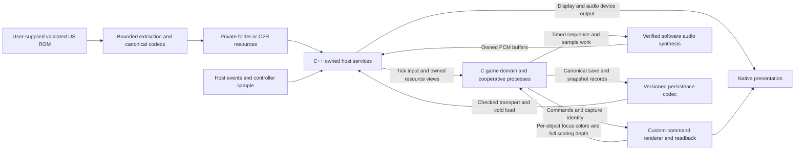

# Architecture and decision register

## Scope, authority and navigation

35mmIsle proposes a faithful native desktop port of **Pokémon Snap (1999)**. This package is planning and source research, not a game implementation, playable build, completed decompilation or compatibility certification. Linux, Windows and macOS are proposed targets, not established support. No ROM, extracted assets, Nintendo/SGI SDK, microcode or reference checkout is part of the deliverable.

This document is the integrated architecture/decision register. [BASELINES](BASELINES.md) freezes all seven source identities and local-state preservation; [DECOMP](DECOMP.md) is game-behavior authority; [LUS / Ghostship](LUS_GHOSTSHIP.md), [2Ship / MM](2SHIP_MM.md) and [Shipwright / OOT](SHIPWRIGHT_OOT.md) supply host/port comparisons. [ROADMAP](ROADMAP.md) alone owns the work-unit dependency/wave table, [VALIDATION](VALIDATION.md) the future behavioral proof contracts, [LICENSING](LICENSING.md) the rights gates, [INVENTORY](INVENTORY.md) the bounded portability screen and [VERIFICATION](VERIFICATION.md) the actual planning-check results. [BEADS](BEADS.md) maps work-unit IDs to live issues; this register does not track task completion.

[ASSESSMENT](ASSESSMENT.md) records the independent planner/reviewer method, parent adjudication H1–H8, rejected alternatives and falsifying experiments. It is a planning decision record, not runtime evidence or a second issue-status ledger.

**Observed:** upstream `ethteck/pokemonsnap` is a WIP and the source/layout authority at the BASELINES pin. The modified local fork is preserved, not implicitly imported. The exact initial ROM identity is US/North America normalized z64 SHA-1 `edc7c49cc568c045fe48be0d18011c30f393cbaf`. Path counts, source availability, a matched reconstruction or another game's native port cannot establish Snap portability or completion. **Proposed:** every architectural contract below awaits its named evidence. No implementation or runtime result is asserted by adopting a direction in this plan.

## Faithful completion contract

The required path is **cold launch → title/new or loaded game → course selection → course travel, original Pokémon/item/environment interactions and camera/zoom/focus/shutter → course end and photo selection → Oak evaluation → report/photo comparison and progression → album/gallery → save → process exit → cold reload and photo replay**. It must preserve the original course-photo limit, report replacement, album add/view/comment/reorder/delete behavior, name/settings, unlock/item/sign/special-event paths and original sound events.

Coverage includes **Beach, Tunnel, Volcano, River, Cave, Valley and Rainbow Cloud**, actual progression between them, ending and credits, and post-completion return/replay/save/reload. Progression is reached through gameplay, not debug unlocks. Photos are replayable scene snapshots, not screenshots: leaving a course cannot make its report/album/gallery photos unusable. Music, cries, shutter/item/UI effects, voice allocation/reverb and scene/ending transitions are required behavior, not post-release polish.

This is the original core loop, not an enhancement project. Randomizers, alternate assets, mod/scripting frameworks, interpolated/high-frame-rate gameplay, new UI frameworks, save states, online features, additional ROM regions and broader LUS platforms are not adopted. Printer-unavailable routing must be truthful; physical-printer/export support is a separate scope decision, not fabricated successful hardware commands. [VALIDATION](VALIDATION.md#behavioral-acceptance-matrix) defines capacities, boundaries, negative cases and the full-loop evidence rather than reducing completion to one course or one image.

## Proposed architecture and dataflow

Keep the **game domain in C** where practical: object/process behavior, simulation state, input interpretation, progression, snapshot/reconstruction/scoring semantics, audio event/sequencing semantics and canonical data codecs. Compose **owned host services in C++** around the pinned LUS facilities: application/window/deck, resources, rendering/readback, PCM device transport, disk transport and platform lifecycle. This split follows mature-port boundaries without importing Zelda/SM64 gameplay or their abstractions.

The diagram shows data ownership and the two render-to-game feedback paths, not work scheduling or a second roadmap DAG. All boxes describe future components.

### Narrow linkage and explicit ownership

The C-linkage boundary exposes initialization/shutdown, one authoritative simulation tick, logical input snapshots, typed resource resolution, render submission/capture completion, PCM submission and checked save transport. C-visible types specify widths, counts, ownership, validity and errors. Do not expose C++ containers, dependency internals or exceptions to gameplay. Host exceptions are contained and converted to explicit failures; no retained raw pointer outlives its owning resource, scene or submission. Thread ownership and cancellation/completion are part of each boundary, not inferred from SDK-shaped names.

The host composition owner controls dependency pins/build options, ABI headers, bridge binding, scene registry and shared tick/task/event definitions. W05 owns validated immutable wire decoding/endian/offset/resource identity; W12 owns mutable sequence/player/synthesis state, sample decompression/resampling and PCM; W07 owns task/queue transport and acceptance/cancellation. No duplicate audio codec is admitted. A changed shared contract migrates every caller and invalidates affected evidence. Clean cutover removes obsolete SDK paths and incompatible aliases rather than retaining a second implementation or no-op facade. Required unresolved assembly/SDK semantics block their consumers until a rights-permissible native implementation exists.

### One gameplay timeline, preserved process stacks

A canonical simulation timeline owns object/process traversal, logical input consumption, pause/resume, RNG, scene transitions, shutter state and **game-originated sound requests**, not every audio-service transition. Independently retrace/sample-paced audio and input service phases follow measured original ordering/coalescing; audio progression is not forced one-to-one with completed gameplay updates. Display refresh, GPU completion and device callbacks cannot advance gameplay. W04 freezes a cross-domain ordering table and stall/pause trace: gameplay updates, retraces, input accumulation/consumption, synthesis sample cursors, startup acknowledgments, task completion and tick draining. Clock mappings remain explicit rather than becoming a universal 60 Hz catch-up loop; [DECOMP](DECOMP.md) and [VALIDATION](VALIDATION.md) own source semantics and trace requirements.

Kind-0 processes preserve nested suspension, locals and original traversal/current-global semantics; kind-1 callbacks remain synchronous, including callback return/self-end. W04 compares separate-stack contexts, **strictly serialized native-thread handoff**, and fully suspension-transitive state-machine conversion. Restarted callbacks and freely concurrent actors are not equivalents. No continuation API is selected. Admission requires native stack size/alignment/overflow, FP initialization/control preservation, zero waits, normal return, deferred reclamation, cancellation/wakeup/join and compiler/ABI/supported-sanitizer evidence before W07. Owned platform workers cannot become a second gameplay owner.

### Address domains, native code and scene lifetime

Separate **host pointers**, **canonical serialized integers/offsets**, **ROM locations**, **segmented tokens** and **overlay-qualified identities**. Two overlays may reuse the same N64 VRAM; that integer alone is not a stable resource key. Decode and relocate through typed resolvers with explicit asset/overlay identity, bounds and lifetime. Host runtime command/pointer structures may widen; stored words retain their specified widths/endian rules. No global `u32 → uintptr_t`, segmented-address identity macro, native struct dump or ROM-byte cast can establish this contract. Heap alignment/masks, capacities and message payloads require LP64/LLP64/high-address evidence, not typedef changes alone.

Use tagged null, root (`1`) and current-framebuffer (`-1`) selectors rather than pointer-shaped sentinel widening. Check native offsets, strides and allocation arithmetic independently of wire layouts. The audio ABI must identify `Acmd` stride/endian, signed-32 DMA callback/address operands, ROM/DMEM/resource tokens versus host pointers, and high-address sample/output/persistent-state resolution; widening an outer task pointer or every command word is not proof.

Compile admitted game code into the native program; replace executable DMA with **explicit scene initialization, reset and destruction** plus typed asset residency. Restore initialized overlay data as well as BSS: original overlay loading reloads bytes, not only zeroed storage. Distinguish overlay data/BSS, scene heap, player-only audio reset, full audio-asset reset and persistent state, with quiescence before reclamation. Scene exit cancels/destroys processes and queued uses in defined order; snapshots retain logical state, not live object pointers. Photo replay independently reacquires required course models, animations, materials, effects, sky/time and camera resources. No future build depends on reference-cache paths or linker-address subtraction inherited as a host heap size.

### Local ROM resources and canonical storage

A local user-ROM pipeline recognizes supported byte orders, validates the exact normalized identity **before** extraction, performs bounded format-specific decoding/relocation, and publishes a validated private resource set only after success. Reject wrong games/revisions, truncation, bad offsets, missing dependencies and unsupported schemas without corrupting an existing valid cache. VPK0, images, models, animations, text, audio and command data need their own reviewed semantics; extraction/ZIP packaging is not conversion or complete resource support.

Use an extensionless development **folder archive**, then **O2R** for release-side local resources, with the same logical paths and canonical values. Register Snap-specific format/type/version factories explicitly; ROM identity, extraction/schema version and application version are separate. Define override/invalidation policy rather than promising hot reload. Retain owners through every game/Gfx/audio consumer and completion. Ghostship/Torch is an extraction pattern, not Snap rules or an implicitly imported toolchain. Public source/packages contain only reviewed permitted material; private generated game resources are not bundled.

Snapshots/saves use explicit canonical field encodings, not host padding, bitfields or pointers. W11 chooses a compatible original payload versus a separately specified native encoding inside a versioned envelope; original-save interoperability is unproved until real round trips pass. Preserve progress, report/additional/album photos, comments, settings and snapshot reconstruction semantics, including original integrity/version interpretation. Native disk transport adds checked complete writes, file flush, same-filesystem replacement, OS-specific durability and recovery, and explicit failures. Unknown/corrupt versions remain intact; failed writes never report success or overwrite the last durable generation. LUS configuration persistence and another game's save JSON are not Snap saves.

### Graphics and photography are game semantics

Select compile-time GBI layout and runtime decoder separately. W06 must identify actual task/in-list microcode paths and prove custom matrix arithmetic/partial writes (`G_SPECIAL_1`, `G_MW_MATRIX`), reload/reset and clipping semantics; named opcode handlers or a generic F3DEX2 name are not admission. Folder/exporter/native-generated display lists must agree on command stride, pointer width, vertex representation, endianness, relocation and resource lifetime.

Two distinct CPU-visible renderer contracts are mandatory:

- **Live focus:** ordered per-object **8×8 RGBA16 center-region** captures, alternating snapshot/frame contexts, the **≥32 changed-pixel** criterion and later qualifying draw winner, completed before focus/shutter consumption. Final-framebuffer reads, raycasts and object-ID picking change behavior. Stock API crop arguments/readback timing do not establish this contract.
- **Photo evaluation:** complete two separately reset/reconstructed passes from recorded world/material/effect/camera state: wide **60°** then normal **30° vertical FOV**, near **10**, far **25600**, **4:3**, **64×48 viewport/scissor**. Preserve ordered isolated-and-scene subject draws, target copy/clear boundaries and original count rectangles. Provide canonical `u16` current, per-Pokémon and pre-Pokémon depth with `0xFFFC` sentinel before CPU scoring. Retain references until each pass completes; one mutable reconstructed world/command stream or a crop-derived pass is not admitted without equivalence proof. [DECOMP](DECOMP.md) owns the source recipe.

The canonical feedback boundary remains architecture-neutral: GPU, software, integer/compute and hybrid execution are unselected. W06 discriminates target/alias switching, contiguous depth clears, depth-as-color bit copies, both subject draws, packed-Z compare/write, coverage/alpha/dither, original RDP AA, and matrix/ucode semantics. Faithful export cannot repair incorrect earlier raster decisions. Original RDP AA is not optional host MSAA; hidden-state sufficiency is an experiment, not an established full-emulator requirement.

Default acceptance is **exact canonical live-focus words and raw packed scoring-depth words**, plus exact per-pixel predicates, counts and decisions. A renderer cannot choose weaker obligations by promising less. Any observational-equivalence alternative requires a separately reviewed contract revision proving all downstream raster/copy/predicate behavior; matching totals is insufficient. Calibrated presentation tolerances never apply to feedback. Each enabled backend needs its own evidence; no fabricated buffers.

Required feedback execution is independent of optional host presentation readiness. Distinguish an original omitted draw from a host frame drop; a `false` presentation return cannot discard required feedback. Accepted/completed/failed/cancelled outcomes retain owners and preserve original publication/shutter/scoring consumer order, never black/no-focus fallback. [LUS / Ghostship](LUS_GHOSTSHIP.md) and [VALIDATION](VALIDATION.md) own integration and comparison details.

### Actual synthesis, then original-scene boot

The audio path is **game sequencing and decoded immutable resources → verified mutable producer/synthesis state → owned signed PCM → checked real-device sink**. LUS is transport, not an N64 interpreter. W12 separately proves event/resource/occupancy history → producer commands/state/sample quotas, commands/state → calibrated PCM, and PCM → actual device output. Preserve voice allocation, envelopes, pitch/pan/volume, ADPCM/loops/resampling, reverb and sequence transitions under the W04 clock mapping. Device conversion/latency cannot advance gameplay; captured-command replay alone cannot qualify the producer.

W02 first demonstrates one short cold-start acquisition/replay recipe, then expands to unchanged startup-through-ending coverage. Its manifest records update/retrace/service identities, clock observations, sample quotas/AI occupancy, task order, initial/reset/mixer history and command address/resource dependencies. Photo captures observe completed live tiles before shared-bank reuse and both completed scoring buffers before clearing/reconstruction, with object order, context/submission generation, transforms/raster state and instrumentation-perturbation checks. Hardware video cannot reveal hidden buffers; independent-reference observability limits remain explicit.

W12 consumes W02 with W04 timing, W05 immutable resources and W07 lifecycle contracts. **Full W12 completion, real audio readiness and shutdown proof precede W08 full original-scene boot and closure.** Earlier bounded nonplayable experiments do not admit a partially qualified full scene. W08–W10/W13 then qualify integrated event production. LUS void submission/occupancy is not whole-buffer acceptance: account generated frames through explicit whole/partial acceptance, failure/backpressure, actual backend versus Null fallback, copy/retention lifetime, device loss and shutdown. Bootstrap queue credits are not completed tasks.

### Owned shutdown and proposed platforms

Shutdown stops admission, safely terminates/cancels continuations, resolves accepted work exactly once as completed/failed/cancelled, and explicitly resolves pending saves. Rejected work retains ownership. Prevent stale completions by drain-before-reuse or generation identity; cancellation cannot free accessed storage. Wake blocked waiters before joining workers and release PCM/GPU/resource owners only after users are quiescent. Device loss/reset/exit must not fabricate success. W07 owns the drain/cancel contract, exercised again with W12 and persistence; no mandatory telemetry framework is implied.

Proposed initial qualification is Linux x86-64, Windows x86-64 and macOS arm64, including LP64/LLP64 and GCC-compatible/MSVC-compatible compiler families. OpenGL, Windows Direct3D 11 and macOS Metal are candidate backend cells, not proven availability/parity. [VALIDATION](VALIDATION.md#platform-compiler-and-presentation-matrix) controls the native matrix and fault/presentation stimuli; another OS, backend or cross-build cannot substitute for a missing required cell. Asset-free clean-machine packages, writable per-user save/cache paths, dependency notices and actual full-loop operation are W15 obligations after W14, not consequences of adopting LUS.

## Decision register

Status describes the planning disposition, **not implemented/completed work**. “Chosen direction” still requires its proof; “conditional” means the resolving evidence must select an admissible implementation before dependent work proceeds. The W IDs link conceptually to [ROADMAP](ROADMAP.md#work-unit-dag), not a second dependency/status table.

| ID | Choice and reason | Planning status | Resolving experiment / stop boundary |
|---|---|---|---|
| D01 | Pinned upstream/exact US ROM; retain local fork untouched. Authority must not drift into unreviewed local behavior. | Chosen direction | W00/W01 rights/definition mapping and per-intended-delta retain/rederive/reject ledger. Unknown required semantics or rights block import/consumer. |
| D02 | C game / C++ owned host with narrow C linkage; avoid dependency leakage and competing subsystem owners. | Chosen direction | W03 real ABI/message/high-address tests across LP64/LLP64; W07 owned startup/shutdown. No pointer truncation, escaped exceptions or stale bridge users. |
| D03 | Standalone audited LUS pin with deliberately adapted seams, not Ghostship wholesale. Current APIs/options differ. | Conditional dependency freeze | W01 resolves template/current-LUS API, GBI and enabled dependency/options manifest; W03 verifies approved linkage. Mixed incompatible pins stop host bring-up. |
| D04 | Nested continuation semantics and synchronous kind-1; one gameplay owner with independently measured service clocks. | Semantics retained; backend/cadence deferred | W04 cross-domain stall/pause order plus nested locals, zero waits, callback/self-end/return, FP, stack, cancellation and supported-toolchain evidence; compare contexts, serialized threads and full conversion. |
| D05 | Typed address/sentinel domains and native lifecycle; initialized overlay data reset as well as BSS. | Amended direction | W03/W05 high-address/token/selector and native offset/stride proof; W07 quiescence; distinguish scene, player-only/full-audio and persistent reset classes. |
| D06 | Validated private user-ROM resources; W05 immutable decoding, W12 mutable audio execution, W07 transport. | Direction chosen; resource coverage unproved | W05 malformed/decode/folder–O2R/lifetime proof; one owner per transformation, no duplicate codec or substitute assets. |
| D07 | Architecture-neutral canonical feedback for live focus and both reconstructed passes; rasterization is not export. | Feasibility and renderer/backend deferred | W06 exact live/raw-depth words, per-pixel predicates and pass/raster/matrix/ucode microcases. Equivalence needs a separately reviewed revision; presentation drops/tolerances cannot weaken feedback. |
| D08 | Full W12 before W08 boot/closure; separate producer, mixer and real sink proof. | Ordering retained; mixer/sink API deferred | W12 startup-to-ending corpus, Acmd/DMA/address ABI, sample quotas, actual acceptance/backend/output and reset/shutdown. No partially qualified full-scene boot, fake completion or Null readiness. |
| D09 | Canonical photo/save codec and checked native transactions; never dump host state. | Direction chosen; payload/schema conditional | W11 valid/corrupt/version/MD4 fixtures, cross-ABI cold replay and write/flush/replace interruption. Unknown format/error must preserve bytes and last good generation; interoperability requires evidence. |
| D10 | Short cold-start oracle bootstrap before corpus expansion; transient capture at completed-work boundaries. | Acquisition/reference unproved | W02 regenerated captures with clock/occupancy/history/resource identities, both scoring passes and shared live tiles before reuse; perturbation and independent-observability checks. Source/video alone cannot certify hidden state. |
| D11 | Original faithful scope; qualify desktop cells/packages only after complete progression. | Proposed release scope | W13 all-course/Oak/report/album/gallery/audio/credits loop; W14 actual native cells; W15 asset-free clean-machine setup/save/reload. Missing required behavior/cell or uncleared material holds release. |
| D12 | H1–H8 paired adjudication; evidence-scoped nonplayable experiments, unchanged whole-unit completion DAG. | Hybrid planning amendment | Separately tracked Beads child/spike with reviewed versioned inputs, material/use rights, surfaces, coverage, falsifier, result and invalidation rules. Evidence does not close a parent, ready blocked production, authorize import or boot a full scene. [ASSESSMENT](ASSESSMENT.md) owns rationale. |

## Prior-art disposition and cutover

These are architectural comparisons, not permission to copy implementations. The linked studies retain the full observed evidence and exact source spans rather than repeating their prose here.

| Reference pair | Adopt / adapt | Reject / do not infer |
|---|---|---|
| [Authoritative Snap](DECOMP.md#reuse-decisions) | Behavior, symbols, snapshot/scoring/save semantics; adapt scheduler, asset residency, rendering and synthesis at explicit seams | Dirty fork as authority; path-count completeness; executable DMA, native struct serialization, ignored opcodes and approximate focus/scoring |
| [LUS / Ghostship](LUS_GHOSTSHIP.md#reuse-decisions) | Owned components/bridge, input/PCM transport and archive/factory pattern; conditionally adapt current renderer | SM64 game loop/CMake/hashes/saves/ucode, old API flags or gitlinks as current-LUS compatibility; SDK success-returning no-ops as operations |
| [2Ship / MM](2SHIP_MM.md#reuse-decisions) | Narrow C/C++ seam, native driver, typed resource/runtime ABI, CPU synthesis and joined shutdown | MM scene/save/game conventions, blanket segment identity, whole-port import, freely concurrent gameplay, randomizer/enhancement scope |
| [Shipwright / OOT](SHIPWRIGHT_OOT.md#reuse-decisions) | Resource identities/factories, ROM normalization, CPU synthesis, explicit persistence and packaging boundaries | OOT cadence/soundfonts/resource schema, pointer-signature shortcuts, point depth as full scoring proof, UI/randomizer/alternate-asset frameworks |

The clean cutover migrates all affected callers under the owning unit; it does not leave a legacy hardware branch, shim or unimplemented success path to make a link succeed. Research closes with evidence and a selected contract; private experiments remain accurately labeled and their scaffolds are removed/replaced before dependent behavior gates close. [ROADMAP's ownership/wave contracts](ROADMAP.md#wave-parallel-slices-and-integration-ownership) govern parallel work after shared interfaces freeze; Beads is the sole live task-state authority.

## Rights, evidence and stop/go policy

[LICENSE](../../LICENSE) grants MIT for original 35mmIsle contributions only. Nintendo/SGI/game/decomp/port/dependency material keeps its own rights; source publication, ROM possession, a matching build, extraction or archive separation is not a grant. The actual proprietary SDK notices and missing/scoped grants in [LICENSING](LICENSING.md) require material-specific review before import/distribution. An affected import can remain blocked while original planning proceeds; no blanket “MIT project” label clears it.

W00 admission is per material and intended use, never blanket permission. Whole-unit W00–W15 criteria, all **34 parent-completion edges** and full-W12-before-W08 policy remain unchanged in [ROADMAP](ROADMAP.md). Earlier bounded **nonplayable** falsification experiments may consume explicitly reviewed/versioned prerequisite evidence only through separately tracked Beads children/spikes with actual inputs, owned surfaces, coverage, falsifier, result and invalidation rules specified before execution. Accepted evidence does not close a parent, ready blocked production, authorize source/payload import or admit full original-scene boot. W01/W02/W06/W11 and W13–W15 retain their original authority, fidelity, photo, persistence, full behavior and release gates; no informal dependency bypass is admitted.

Public evidence is original prose/tooling and reviewed payload-free manifests/diagnostics. ROMs, extracted resources, protected imagery/audio, microcode and raw payload-bearing snapshots/saves remain outside public artifacts. [VERIFICATION](VERIFICATION.md) separates observed document/source/inventory/publication/isolated-ABI checks from all unrun game, renderer, synthesis, save and platform gates. A passing limited fixture proves only its stated coverage; no “100% accurate,” legal-clearance or game-completion claim follows from this package.
