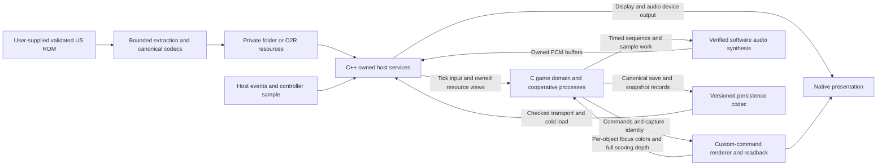

# Architecture and decision register

## Scope, authority and navigation

35mmIsle proposes a faithful native desktop port of **Pokémon Snap (1999)**. This package is planning and source research, not a game implementation, playable build, completed decompilation or compatibility certification. Linux, Windows and macOS are proposed targets, not established support. No ROM, extracted assets, Nintendo/SGI SDK, microcode or reference checkout is part of the deliverable.

This document is the integrated architecture/decision register. [BASELINES](BASELINES.md) freezes all seven source identities and local-state preservation; [DECOMP](DECOMP.md) is game-behavior authority; [LUS / Ghostship](LUS_GHOSTSHIP.md), [2Ship / MM](2SHIP_MM.md) and [Shipwright / OOT](SHIPWRIGHT_OOT.md) supply host/port comparisons. [ROADMAP](ROADMAP.md) alone owns the work-unit dependency/wave table, [VALIDATION](VALIDATION.md) the future behavioral proof contracts, [LICENSING](LICENSING.md) the rights gates, [INVENTORY](INVENTORY.md) the bounded portability screen and [VERIFICATION](VERIFICATION.md) the actual planning-check results. [BEADS](BEADS.md) maps work-unit IDs to live issues; this register does not track task completion.

**Observed:** upstream `ethteck/pokemonsnap` is a WIP and the source/layout authority at the BASELINES pin. The modified local fork is preserved, not implicitly imported. The exact initial ROM identity is US/North America normalized z64 SHA-1 `edc7c49cc568c045fe48be0d18011c30f393cbaf`. Path counts, source availability, a matched reconstruction or another game's native port cannot establish Snap portability or completion. **Proposed:** every architectural contract below awaits its named evidence. No implementation or runtime result is asserted by adopting a direction in this plan.

## Faithful completion contract

The required path is **cold launch → title/new or loaded game → course selection → course travel, original Pokémon/item/environment interactions and camera/zoom/focus/shutter → course end and photo selection → Oak evaluation → report/photo comparison and progression → album/gallery → save → process exit → cold reload and photo replay**. It must preserve the original course-photo limit, report replacement, album add/view/comment/reorder/delete behavior, name/settings, unlock/item/sign/special-event paths and original sound events.

Coverage includes **Beach, Tunnel, Volcano, River, Cave, Valley and Rainbow Cloud**, actual progression between them, ending and credits, and post-completion return/replay/save/reload. Progression is reached through gameplay, not debug unlocks. Photos are replayable scene snapshots, not screenshots: leaving a course cannot make its report/album/gallery photos unusable. Music, cries, shutter/item/UI effects, voice allocation/reverb and scene/ending transitions are required behavior, not post-release polish.

This is the original core loop, not an enhancement project. Randomizers, alternate assets, mod/scripting frameworks, interpolated/high-frame-rate gameplay, new UI frameworks, save states, online features, additional ROM regions and broader LUS platforms are not adopted. Printer-unavailable routing must be truthful; physical-printer/export support is a separate scope decision, not fabricated successful hardware commands. [VALIDATION](VALIDATION.md#behavioral-acceptance-matrix) defines capacities, boundaries, negative cases and the full-loop evidence rather than reducing completion to one course or one image.

## Proposed architecture and dataflow

Keep the **game domain in C** where practical: object/process behavior, simulation state, input interpretation, progression, snapshot/reconstruction/scoring semantics, audio event/sequencing semantics and canonical data codecs. Compose **owned host services in C++** around the pinned LUS facilities: application/window/deck, resources, rendering/readback, PCM device transport, disk transport and platform lifecycle. This split follows mature-port boundaries without importing Zelda/SM64 gameplay or their abstractions.

The diagram shows data ownership and the two render-to-game feedback paths, not work scheduling or a second roadmap DAG. All boxes describe future components.

### Narrow linkage and explicit ownership

The C-linkage boundary exposes initialization/shutdown, one authoritative simulation tick, logical input snapshots, typed resource resolution, render submission/capture completion, PCM submission and checked save transport. C-visible types specify widths, counts, ownership, validity and errors. Do not expose C++ containers, dependency internals or exceptions to gameplay. Host exceptions are contained and converted to explicit failures; no retained raw pointer outlives its owning resource, scene or submission. Thread ownership and cancellation/completion are part of each boundary, not inferred from SDK-shaped names.

The host composition owner controls dependency pins/build options, ABI headers, bridge binding, scene registry and shared tick/task/event definitions. Each subsystem has one owner; parallel slices consume frozen contracts. A changed shared contract migrates every caller and invalidates affected evidence. Clean cutover removes obsolete SDK paths and incompatible aliases rather than retaining a second implementation or no-op facade. Required unresolved assembly/SDK semantics block their consumers until a rights-permissible native implementation exists.

### One gameplay timeline, preserved process stacks

A canonical simulation timeline owns object/process traversal, logical input consumption, pause/resume, RNG, scene transitions, shutter state and audio event time. Display refresh, GPU completion and audio-device callbacks cannot advance gameplay. Preserve original update/draw intervals and measured tick-draining behavior rather than inventing a universal 60 Hz catch-up rule. Input edges accumulate/consume at the original phases; monotonic wall time, simulation time, replay/photo world time and device sample time are related explicitly, not merged.

Kind-0 game processes require **stack-preserving cooperative suspension**, including locals and nested `ohWait` calls. Callback kind-1 processes remain synchronous. Preserve object-first traversal, descending process priority, current-object/process globals, wait counts, pause and deferred self/object deletion. Game globals are not mutated by freely parallel process workers. Real platform worker threads may service owned I/O/render/audio work, but cannot replace ordered game continuations. W04 chooses the continuation backend only after reference traces; W07 implements real wakeups/task completion, not the stock LUS nonblocking queue behavior masquerading as SDK blocking.

### Address domains, native code and scene lifetime

Separate **host pointers**, **canonical serialized integers/offsets**, **ROM locations**, **segmented tokens** and **overlay-qualified identities**. Two overlays may reuse the same N64 VRAM; that integer alone is not a stable resource key. Decode and relocate through typed resolvers with explicit asset/overlay identity, bounds and lifetime. Host runtime command/pointer structures may widen; stored words retain their specified widths/endian rules. No global `u32 → uintptr_t`, segmented-address identity macro, native struct dump or ROM-byte cast can establish this contract. Heap alignment/masks, capacities and message payloads require LP64/LLP64/high-address evidence, not typedef changes alone.

Compile admitted game code into the native program; replace executable DMA with **explicit scene initialization, reset and destruction** plus typed asset residency. Reproduce the original overlay BSS/reset scope without wiping persistent shared state. Scene exit cancels/destroys processes and queued uses in defined order; snapshots retain logical state, not live object pointers. Photo replay independently reacquires required course models, animations, materials, effects, sky/time and camera resources. No future build depends on reference-cache paths or linker-address subtraction inherited as a host heap size.

### Local ROM resources and canonical storage

A local user-ROM pipeline recognizes supported byte orders, validates the exact normalized identity **before** extraction, performs bounded format-specific decoding/relocation, and publishes a validated private resource set only after success. Reject wrong games/revisions, truncation, bad offsets, missing dependencies and unsupported schemas without corrupting an existing valid cache. VPK0, images, models, animations, text, audio and command data need their own reviewed semantics; extraction/ZIP packaging is not conversion or complete resource support.

Use an extensionless development **folder archive**, then **O2R** for release-side local resources, with the same logical paths and canonical values. Register Snap-specific format/type/version factories explicitly; ROM identity, extraction/schema version and application version are separate. Define override/invalidation policy rather than promising hot reload. Retain owners through every game/Gfx/audio consumer and completion. Ghostship/Torch is an extraction pattern, not Snap rules or an implicitly imported toolchain. Public source/packages contain only reviewed permitted material; private generated game resources are not bundled.

Snapshots/saves use explicit canonical field encodings, not host padding, bitfields or pointers. W11 chooses a compatible original payload versus a separately specified native encoding inside a versioned envelope; original-save interoperability is unproved until real round trips pass. Preserve progress, report/additional/album photos, comments, settings and snapshot reconstruction semantics, including original integrity/version interpretation. Native disk transport adds checked complete writes, file flush, same-filesystem replacement, OS-specific durability and recovery, and explicit failures. Unknown/corrupt versions remain intact; failed writes never report success or overwrite the last durable generation. LUS configuration persistence and another game's save JSON are not Snap saves.

### Graphics and photography are game semantics

Select compile-time GBI layout and runtime decoder separately. W06 must identify actual task/in-list microcode paths and prove custom matrix behavior, including `G_SPECIAL_1` and `G_MW_MATRIX` updates; a generic F3DEX2 name or ignored unknown opcode is not admission. Folder/exporter/native-generated display lists must agree on command stride, pointer width, vertex representation, endianness, relocation and resource lifetime.

Two distinct CPU-visible renderer contracts are mandatory:

- **Live focus:** ordered per-object **8×8 RGBA16 center-region** captures, alternating snapshot/frame contexts, the **≥32 changed-pixel** criterion and later qualifying draw winner, completed before focus/shutter consumption. Final-framebuffer reads, raycasts and object-ID picking change behavior. Stock API crop arguments/readback timing do not establish this contract.
- **Photo evaluation:** reconstruct recorded scene state and wide/normal passes; provide canonical **64×48 `u16` current, per-Pokémon and pre-Pokémon depth** with **`0xFFFC`** clear sentinel, equality/count semantics and completion before CPU scoring. Point-depth queries or plausible screenshots cannot replace these buffers, selected subject or exact score decisions.

Each enabled backend must prove packing, origin, quantization, custom commands and capture readiness. W06 may choose a dedicated GPU export or a faithful deterministic evaluation path only from measured original-command evidence; bounding-box/approximate scoring is not an alternative. Native 4:3 photo projection/evaluation remains independent of host resize, aspect, MSAA and presentation cadence. A failed backend gate blocks that support claim, not permission to return fabricated buffers.

### Actual synthesis, then original-scene boot

The audio path is **game sequencing/bank/sample loading → verified software synthesis/used audio-command semantics → owned signed-PCM buffers → host output device**. LUS is the sink, not an N64 audio interpreter. Match original voice allocation, envelopes, pitch/pan/volume, ADPCM/loops/resampling, reverb, sequence transitions, event ticks and tick-to-sample behavior. Device conversion/latency cannot change process time. A prerecorded stream, silent AI call or PCM queue without synthesis fails the contract.

W02 establishes the original-reference command/event/PCM corpus; W12 consumes it with W04 timing, W05 assets and W07 lifecycle contracts. **W12 real audio, readiness and shutdown proof precede W08 full original-scene boot.** It does not depend on already-playable native gameplay. W06/early renderer and W07 scheduler experiments are nonplayable; they may not initialize the full original scene while concealing missing audio/services. W08–W10 and W13 then qualify actual integrated scene/game event production, not merely standalone PCM output.

### Owned shutdown and proposed platforms

Shutdown stops accepting game work, terminates/cancels cooperative processes safely, resolves or cancels real in-flight tasks/captures, finishes or explicitly fails pending save commits, stops/joins audio workers and releases PCM/GPU/resource users before archive/bridge/context destruction. Device loss, scene reset and exit while waiting must not fabricate completion or leave references into destroyed owners. The exact drain/cancel order is frozen in W07 and exercised again with W12 and persistence.

Proposed initial qualification is Linux x86-64, Windows x86-64 and macOS arm64, including LP64/LLP64 and GCC-compatible/MSVC-compatible compiler families. OpenGL, Windows Direct3D 11 and macOS Metal are candidate backend cells, not proven availability/parity. [VALIDATION](VALIDATION.md#platform-compiler-and-presentation-matrix) controls the native matrix and fault/presentation stimuli; another OS, backend or cross-build cannot substitute for a missing required cell. Asset-free clean-machine packages, writable per-user save/cache paths, dependency notices and actual full-loop operation are W15 obligations after W14, not consequences of adopting LUS.

## Decision register

Status describes the planning disposition, **not implemented/completed work**. “Chosen direction” still requires its proof; “conditional” means the resolving evidence must select an admissible implementation before dependent work proceeds. The W IDs link conceptually to [ROADMAP](ROADMAP.md#work-unit-dag), not a second dependency/status table.

| ID | Choice and reason | Planning status | Resolving experiment / stop boundary |
|---|---|---|---|
| D01 | Pinned upstream/exact US ROM; retain local fork untouched. Authority must not drift into unreviewed local behavior. | Chosen direction | W00/W01 rights/definition mapping and per-intended-delta retain/rederive/reject ledger. Unknown required semantics or rights block import/consumer. |
| D02 | C game / C++ owned host with narrow C linkage; avoid dependency leakage and competing subsystem owners. | Chosen direction | W03 real ABI/message/high-address tests across LP64/LLP64; W07 owned startup/shutdown. No pointer truncation, escaped exceptions or stale bridge users. |
| D03 | Standalone audited LUS pin with deliberately adapted seams, not Ghostship wholesale. Current APIs/options differ. | Conditional dependency freeze | W01 resolves template/current-LUS API, GBI and enabled dependency/options manifest; W03 verifies approved linkage. Mixed incompatible pins stop host bring-up. |
| D04 | Stackful cooperative game processes, one measured timeline; callbacks/OS workers are not equivalents. | Direction chosen; backend/cadence conditional | W02/W04 nested waits, priority ties, pause/spawn/delete, tick draining and RNG traces; W07 must reproduce resumption/local state/order before W09. |
| D05 | Typed address domains and native scene lifecycle; no executable DMA/ambiguous VRAM key. | Chosen direction | W03/W05 high-address relocation through reused-overlay addresses, heap masks, reset/unload and message tests; required unresolved addresses/assembly stop consuming scenes. |
| D06 | Validated private user-ROM resources; folder then O2R with matching factories/schema. | Chosen direction; resource coverage unproved | W05 bounded representative decode, malformed inputs, folder/O2R equivalence, interrupted publication and lifetime tests. Unknown required format blocks consumer; no substitute assets. |
| D07 | Custom-command interpretation plus two independent canonical photo-feedback paths. Rendering changes decisions. | Conditional feasibility | W06 matrix/geometry traces; per-draw center tiles including 31/32/33-pixel and stale/out-of-order contexts; all scoring depth/sentinel/equality buffers. Any unproved required command or parity blocks faithful photos. |
| D08 | Software synthesis before full-scene boot; host PCM sink is transport only. | Chosen ordering; ABI/backend conditional | W12 executes W02 original startup-to-ending corpus with calibrated PCM, real device/readiness/drift/shutdown proof before W08; later integrated events must match. Missing opcode/sound or fake completion stops boot claim. |
| D09 | Canonical photo/save codec and checked native transactions; never dump host state. | Direction chosen; payload/schema conditional | W11 valid/corrupt/version/MD4 fixtures, cross-ABI cold replay and write/flush/replace interruption. Unknown format/error must preserve bytes and last good generation; interoperability requires evidence. |
| D10 | Independent original-reference oracle/fixtures before fidelity claims. Source inspection is not execution. | Conditional reference selection | W02 repeats cold captures with seed/clock/input control and independently cross-checks depth/audio-sensitive cases. Unexplained reference disagreement blocks comparisons, not wider tolerances. |
| D11 | Original faithful scope; qualify desktop cells/packages only after complete progression. | Proposed release scope | W13 all-course/Oak/report/album/gallery/audio/credits loop; W14 actual native cells; W15 asset-free clean-machine setup/save/reload. Missing required behavior/cell or uncleared material holds release. |

## Prior-art disposition and cutover

These are architectural comparisons, not permission to copy implementations. The linked studies retain the full observed evidence and exact source spans rather than repeating their prose here.

| Reference pair | Adopt / adapt | Reject / do not infer |
|---|---|---|
| [Authoritative Snap](DECOMP.md#reuse-decisions) | Behavior, symbols, snapshot/scoring/save semantics; adapt scheduler, asset residency, rendering and synthesis at explicit seams | Dirty fork as authority; path-count completeness; executable DMA, native struct serialization, ignored opcodes and approximate focus/scoring |
| [LUS / Ghostship](LUS_GHOSTSHIP.md#reuse-decisions) | Owned components/bridge, input/PCM transport and archive/factory pattern; conditionally adapt current renderer | SM64 game loop/CMake/hashes/saves/ucode, old API flags or gitlinks as current-LUS compatibility; SDK success-returning no-ops as operations |
| [2Ship / MM](2SHIP_MM.md#reuse-decisions) | Narrow C/C++ seam, native driver, typed resource/runtime ABI, CPU synthesis and joined shutdown | MM scene/save/game conventions, blanket segment identity, whole-port import, freely concurrent gameplay, randomizer/enhancement scope |
| [Shipwright / OOT](SHIPWRIGHT_OOT.md#reuse-decisions) | Resource identities/factories, ROM normalization, CPU synthesis, explicit persistence and packaging boundaries | OOT cadence/soundfonts/resource schema, pointer-signature shortcuts, point depth as full scoring proof, UI/randomizer/alternate-asset frameworks |

The clean cutover migrates all affected callers under the owning unit; it does not leave a legacy hardware branch, shim or unimplemented success path to make a link succeed. Research closes with evidence and a selected contract; private experiments remain accurately labeled and their scaffolds are removed/replaced before dependent behavior gates close. [ROADMAP's ownership/wave contracts](ROADMAP.md#wave-parallel-slices-and-integration-ownership) govern parallel work after shared interfaces freeze; Beads is the sole live task-state authority.

## Rights, evidence and stop/go policy

[LICENSE](../../LICENSE) grants MIT for original 35mmIsle contributions only. Nintendo/SGI/game/decomp/port/dependency material keeps its own rights; source publication, ROM possession, a matching build, extraction or archive separation is not a grant. The actual proprietary SDK notices and missing/scoped grants in [LICENSING](LICENSING.md) require material-specific review before import/distribution. An affected import can remain blocked while original planning proceeds; no blanket “MIT project” label clears it.

W00 rights admission precedes imported implementation/payload. W01 authority/ABI reconciliation and W02 calibrated private fixtures precede technical fidelity claims; W06 render/photo feasibility precedes photo implementation; W12 real synthesis precedes W08 full-scene boot; W11 cold persistence precedes complete progression qualification; W13–W15 govern complete behavior, native support and packaged release. The exact dependencies remain solely in ROADMAP. Open questions above are bounded resolving experiments with explicit failure consequences, not placeholders or invitations to invent new feature scope.

Public evidence is original prose/tooling and reviewed payload-free manifests/diagnostics. ROMs, extracted resources, protected imagery/audio, microcode and raw payload-bearing snapshots/saves remain outside public artifacts. [VERIFICATION](VERIFICATION.md) separates observed document/source/inventory/publication/isolated-ABI checks from all unrun game, renderer, synthesis, save and platform gates. A passing limited fixture proves only its stated coverage; no “100% accurate,” legal-clearance or game-completion claim follows from this package.
